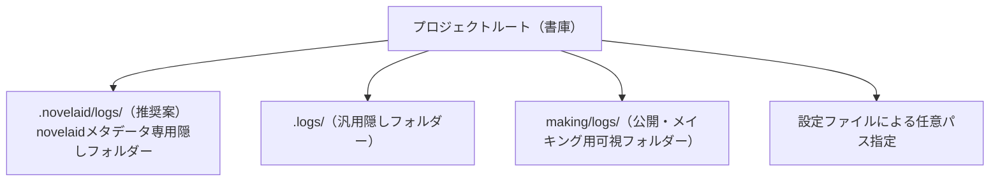

# AI執筆作業記録とプロンプトログ保存仕様書

## 1. 背景と目的

近年、小説執筆支援やアイデア出しにおいて生成AIの活用が急速に広まる一方、各種小説投稿サイトのコンテスト（カクヨムWeb小説短編賞、電撃小説大賞、各種出版社の公募など）において**「AI利用ガイドライン」**が明確化されつつあります。

多くのコンテストでは、以下の要件が求められる、あるいは推奨される傾向にあります：
- **AI利用の有無の開示**: アイデア出し、文章生成、校正、ルビ振り等、どの工程でAIを使用したか。
- **使用ツール・モデル名の記録**: 使用したAIツール（novelaid-cli等）および推論モデル（GPT-4, Claude, Gemini, ローカルLLM等）。
- **プロンプトおよび出力結果の提出・提示**: 「どのような指示（プロンプト）を与え、AIが何を返したか」の時系列ログ。

本機能は、作家が `novelaid-cli` を使って執筆・推敲・設定相談を行った全対話ログを自動で記録・管理し、**小説コンテストや出版社への提出用「AI利用証明ログ（監査証跡）」**、および**作家自身の執筆メイキング記録**として手軽に活用できるようにすることを目的とします。

---

## 2. システム要件と記録内容

### 2.1 記録すべきデータ項目
1つの記録単位（対話ターンまたはセッション）につき、以下の情報を構造化して記録します。

| 項目 | 説明 | 備考 |
|---|---|---|
| **タイムスタンプ** | 対話・実行が行われた日時（ISO 8601 / `YYYY-MM-DD HH:mm:ss`） | 時系列証明 |
| **ユーザープロンプト** | 作家が入力した指示・質問の原文 | 提出時の必須項目 |
| **AI応答テキスト** | AIが生成・出力した回答内容 | ストリーミング完了後の確定テキスト |
| **使用モデル** | プロバイダー名およびモデルID（例: `lm-studio/qwen-2.5-7b`） | 応募要件で頻出 |
| **作業フォルダー・文脈** | 現在の作業フォルダー（`10_novels` 等）およびDocumentType | どの原稿に対する指示かを特定 |
| **ツール実行・ファイル変更** | `read`, `edit` ツール等で参照・書き換えたファイル名と差分概要 | 改変箇所の客観的証明 |

### 2.2 出力フォーマット
1. **Markdown形式（標準・人間可読）**:
   - 本プロジェクトの `making/logs/YYYY-MM-DD.md` と同様の可読性の高いMarkdown構造。
   - 目視での確認、ブログ記事（note等）への転記、PDF化しての提出が容易。
2. **JSON / JSONL形式（機械可読・将来拡張）**:
   - Webフォームや応募システムへの機械的アップロード、集計・分析用のメタデータフォーマット。

---

## 3. 保存先フォルダーと設定管理の設計

### 3.1 保存先フォルダーの候補比較
プロジェクトルートを基準とした保存場所について、以下の候補を検討します。

| 案 | パス | メリット | デメリット / 考慮点 |
|---|---|---|---|
| **案A（推奨）** | `.novelaid/logs/` | ツール固有のメタデータ（設定・キャッシュ・ログ）を一元管理でき、作品フォルダーを汚さない。Gitでも除外/追跡を選択しやすい。 | 初心者には隠しフォルダー（`.`始まり）が見えにくい場合がある。 |
| **案B** | `.logs/` | 一般的な開発慣習に近くシンプル。 | 他のツールや一般的なログと競合する可能性がある。 |
| **案C** | `making/logs/` | 本リポジトリのように「メイキング自体を作品の一部として公開する」場合に直感的。 | 純粋に小説原稿のみを管理したい作家にとっては不要な公開フォルダーに見える。 |
| **案D** | 設定ファイルによる指定 | 作家の運用方針（Git管理するか、別フォルダーに退避するか等）に完全柔軟に対応。 | 設定の仕組みを構築・維持する必要がある。 |

**【設計結論】**:
- **デフォルト**: プロジェクトルート配下の `.novelaid/logs/YYYY-MM-DD.md` に自動保存。
- **設定によるカスタマイズ**: 設定ファイル（後述）により、保存先ディレクトリや自動記録のON/OFF、提出用フォルダーへの出力切り替えを可能にする。

---

## 4. Pi SDK標準の設定管理・ログ永続化の調査課題

本機能を実装するにあたり、Pi Coding Agent SDKが標準で備えている設定管理やセッション永続化機構をフル活用し、車輪の再発明を避けるための調査を行います。

### 4.1 調査項目一覧
1. **Pi SDK の設定永続化機構**:
   - `SettingsManager` や CLI オプションパーサーに、プロジェクト固有の設定（`.pi/` や `settings.json` 等）を読み書きする公式APIが存在するか。
   - `novelaid-cli` 独自の設定ファイル（例: `.novelaidrc` または `.novelaid/config.json`）の配置・読み込み戦略。
2. **セッション履歴の保存・エクスポート機構**:
   - Pi SDK 標準の `SessionManager` はどのように会話ログをディスクに永続化しているか（セッションファイルの保存先とスキーマ）。
   - SDK標準コマンド `/export`（会話履歴のエクスポート）の出力形式と、それを小説用提出フォーマットに変換・流用可能か。
3. **イベントフックの活用**:
   - `InlineExtension` の `session_start`, `before_agent_start`, `agent_end` などのイベントフックを活用し、ユーザー入力とAI最終出力を取りこぼしなくインターセプトして日次Markdownファイルへ自動追記（Append）できるか。

---

## 5. 開発計画（実装ステップ）

1. **Step 5-1: Pi SDK設定管理・セッション履歴・イベントフックの技術調査**:
   - Pi SDKのセッションログ構造、設定ファイル読み込み仕様の確認。
   - イベントリスナーによるプロンプト・応答の抽出可否の検証。
2. **Step 5-2: ログ保存エンジン（`LogRecorder`）の設計・実装**:
   - `src/workspace/logger.ts`（仮）の作成。
   - `.novelaid/logs/YYYY-MM-DD.md` への自動日次ローテーション追記ロジックの実装。
   - 記録項目（時刻、プロンプト、応答、モデル名、DocumentType、差分）の構造化。
3. **Step 5-3: スラッシュコマンド（`/logs`, `/export-prompt`）および設定機能の実装**:
   - ログ保存フォルダーを開く／一覧表示するコマンドや、コンテスト提出用に特定期間・特定エピソードのプロンプトを単一ファイルにまとめるエクスポート機能の実装。
4. **Step 5-4: 単体テスト・E2Eテストおよび動作検証**:
   - サンプルプロジェクトでの自動記録検証と提出用Markdown生成のテスト。
