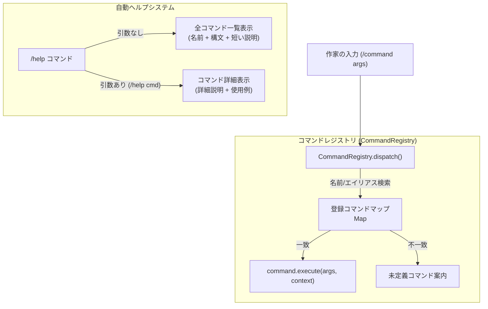

# CLIコマンド管理仕様書

本書は、`novelaid-cli` の対話セッション内において作家（ユーザー）が入力するスラッシュコマンド（`/help`, `/exit`, `/model` など）を一元管理するための設計仕様書です。

---

## 1. 目的と設計方針

### 1.1 背景と課題
従来の対話セッション実装では、コマンドの条件分岐（`if-else`）とヘルプメッセージ（`/help`）が別々にハードコードされていたため、以下の課題がありました。
1. **実装漏れ・更新漏れのリスク**: コマンドの追加や変更時に、分岐ロジックとヘルプ表示の双方を修正する必要があり、ドキュメントとの不整合が発生しやすい。
2. **詳細ヘルプ・引数の欠落**: コマンドごとの引数（例: `/model <モデル名>`）や詳細な使い方の提示が難しい。
3. **拡張性の低さ**: 将来的に小説設定の読み込み（`/context`）や執筆補助コマンドが増加した際、コードが肥大化・複雑化する。

### 1.2 設計方針
- **宣言的定義（Single Source of Truth）**: コマンドの名前、エイリアス、構文、短い説明、詳細説明、実行処理を1つのオブジェクトとして定義します。
- **レジストリによる一元管理（CommandRegistry）**: コマンドの登録・ディスパッチ（実行判定）・ヘルプ生成を専用のレジストリクラスに集約します。
- **自動ヘルプ生成**: 登録情報から一覧ヘルプおよび個別詳細ヘルプ（`/help <コマンド名>`）を自動生成し、手動メンテナンスを不要にします。

---

## 2. アーキテクチャとクラス設計



### 2.1 型定義（TypeScript）

```typescript
/**
 * コマンド実行時に渡されるコンテキスト情報
 */
export interface CommandContext {
  /** 現在のアクティブな AgentSession */
  session: AgentSession;
  /** モデルおよび認証を管理する ModelRuntime */
  runtime: ModelRuntime;
  /** セッション対話ループの終了を要求するコールバック */
  requestExit: () => void;
  /** ターミナル画面の消去を実行するコールバック */
  clearScreen: () => void;
  /** ターミナルへのメッセージ出力関数 */
  print: (message: string) => void;
  /** 現在選択されているモデル情報 */
  currentModel: {
    id: string;
    name: string;
    contextWindow: number;
  };
}

/**
 * コマンドの宣言的定義
 */
export interface CommandDefinition {
  /** コマンドのプライマリ名（先頭のスラッシュは含めない。例: "help", "model"） */
  name: string;
  /** コマンドの別名（例: ["quit", "q"]） */
  aliases?: string[];
  /** 引数の構文表記（例: "[コマンド名]", "<モデル名>"） */
  usage?: string;
  /** 短い説明（一覧ヘルプ表示用） */
  description: string;
  /** 詳細な説明（/help <コマンド名> で表示する使用方法や仕様） */
  detail?: string;
  /** コマンドの実行ロジック */
  execute: (args: string, context: CommandContext) => Promise<void> | void;
}
```

### 2.2 `CommandRegistry` クラスの責務

| メソッド | 責務と動作仕様 |
|---|---|
| `register(command: CommandDefinition)` | コマンドを登録。プライマリ名および各エイリアスをルックアップマップに索引化する。重複する名前がある場合はエラーを投げる。 |
| `get(nameOrAlias: string)` | 指定された名前またはエイリアスに対応する `CommandDefinition` を取得する。 |
| `getAll()` | 登録されている重複のないコマンド定義の一覧（プライマリ名基準）を取得する。 |
| `dispatch(input: string, context: CommandContext)` | 入力文字列が `/` で始まるかを判定し、コマンド名と引数に分解して該当コマンドを実行する。一致しない場合は親切なエラー案内を表示する。 |
| `formatHelp(commandName?: string)` | 引数なしの場合は登録全コマンドの一覧表、引数指定時は個別詳細ヘルプを整形文字列として返す。 |

---

## 3. ヘルプ表示の出力仕様

### 3.1 一覧ヘルプ（`/help`）
登録された全コマンドの名前、構文、短い説明を整列して表示します。

```text
【利用可能なコマンド一覧】
  /help [コマンド名]    利用可能なコマンド一覧または詳細ヘルプを表示します
  /model [モデル名]    現在のモデル情報の表示、またはモデルの切り替えを行います
  /clear               ターミナル画面を消去します
  /exit                対話セッションを終了してCLIを抜けます (エイリアス: /quit, /q)

※ 各コマンドの詳細な使い方は「/help <コマンド名>」で確認できます。
```

### 3.2 個別詳細ヘルプ（`/help model` など）
指定されたコマンドの構文、エイリアス、詳細説明、使用例を表示します。

```text
【コマンド詳細: /model】
構文: /model [モデル名]
エイリアス: なし
概要: 現在のモデル情報の表示、またはモデルの切り替えを行います

[詳細説明]
引数を指定せずに実行した場合は、現在セッションに設定されているモデル名と
利用可能なコンテキスト窓サイズを表示します。
引数にモデル名を指定した場合は、利用可能なモデル一覧から指定されたモデルへ
セッションの推論先を切り替えます。
```

---

## 4. 初期ビルトインコマンド一覧

| コマンド | エイリアス | 構文 | 概要 |
|---|---|---|---|
| `help` | `?` | `/help [コマンド名]` | コマンド一覧または指定コマンドの詳細ヘルプを表示 |
| `model` | なし | `/model [モデル名]` | 現在のモデル情報の表示（将来的に動的切り替え） |
| `clear` | `cls` | `/clear` | ターミナル画面の消去 |
| `exit` | `quit`, `q` | `/exit` | 対話セッションの終了 |

### 4.1 将来の拡張コマンド（Step 3 以降で追加予定）
- `/context [ファイル名]`: 小説の世界観設定資料やキャラクターシートの読み込み・確認
- `/persona [タイプ]`: AIエージェントの壁打ち姿勢（厳しめ編集者、共感型アシスタント等）の切り替え
- `/session [info|save|restore]`: 会話履歴の保存・復元
