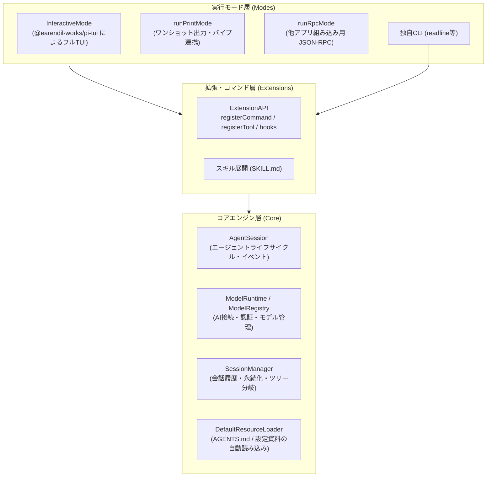

# Pi Coding Agent SDK 仕様調査書

本書は、`novelaid-cli` のコアエンジンとして採用している **Pi Coding Agent SDK（`@earendil-works/pi-coding-agent`）** の標準機能、内部アーキテクチャ、および拡張機構について調査した結果をまとめた技術資料です。

---

## 1. SDKのアーキテクチャ全体像

Pi Coding Agent SDK は、下図のように **「コアエンジン層」「拡張機構（Extension）層」「実行モード（Mode/UI）層」** の3層に明確に分離された設計となっています。

---

## 2. 標準で内蔵・自動有効化される機能

`createAgentSession()` を呼び出すだけで、コアエンジン層が標準で提供する機能は以下の通りです。

### 2.1 プロジェクトコンテキストファイル（`AGENTS.md`）の自動読み込み
* **動作仕様**:
  - `DefaultResourceLoader` がカレントディレクトリ（`cwd`）から上位階層へ向かって探索を行い、最初に見つかった `AGENTS.md`（または `CLAUDE.md`, `AGENTS.override.md`）を自動的に読み込みます。
  - 同時に、ユーザーグローバル設定（`~/.pi/agent/AGENTS.md`）も探索・結合されます。
  - 読み込まれた内容は、モデル送信時のシステムプロンプト内に「プロジェクト指示（Project Instructions）」として自動注入されます。
* **小説執筆における活用**:
  - プロジェクトルートに `AGENTS.md` を配置するだけで、小説の世界観や執筆ルール、文体指示をコード記述ゼロでAIに把握させることができます。

### 2.2 スキル（`SKILL.md`）の自動探索とプロンプト展開
* **標準探索パス**:
  1. プロジェクトローカル: `<cwd>/.pi/skills/**/SKILL.md`
  2. ユーザーグローバル: `~/.pi/agent/skills/**/SKILL.md`
* **動作仕様**:
  - 標準パス内のスキルは自動的にカタログ化され、プロンプト内でスキル指定（例: `invoke_subagent` やスキルブロック記法）を行った際に自動展開されます。
  - ※ リポジトリ独自のパス（例: `.agents/skills/`）から読み込ませたい場合は、`ResourceLoader` のオプション（`additionalSkillPaths`）で明示的に指定する必要があります。

### 2.3 認証とアカウント管理（`auth.json`）
* **動作仕様**:
  - `ModelRuntime` は、`~/.pi/agent/auth.json` に保存された各種プロバイダー（OpenAI, Anthropic, Gemini, GitHub等）の認証情報・APIキーを自動読み込みします。
  - 動的なAPIキー設定（`setRuntimeApiKey`）や OAuth ログイン（`login`）のバックエンド処理が標準で備わっています。

### 2.4 会話履歴の永続化とブランチ管理（`SessionManager`）
* **動作仕様**:
  - セッション内の発言やターンは `SessionManager` により自動でシリアライズされ、セッションファイル（JSONL形式）として保存されます。
  - Gitのようなツリー構造の会話分岐（ブランチ切り替え）を内部でネイティブサポートしています。

---

## 3. 実行モード（UI層）の違いと特徴

SDKには、用途に応じた複数の実行モードが用意されています。

| モード | 実装クラス/関数 | 主な特徴と小説執筆における用途 |
|---|---|---|
| **標準フルTUI** | `InteractiveMode` (`@earendil-works/pi-tui`) | **公式の `pi` と全く同じリッチな画面**。 - 上部: スクロール可能なチャットログ（Markdown整形描画、枠線） - 下部: 複数行対応エディタ入力欄 - フッター: 現在モデル名、消費トークン数、費用 - **専用ダイアログ**: `/login` (認証UI), `/model` (選択メニュー), `/tree` (セッション分岐ツリー) をポップアップ表示。 **IDEの統合ターミナルでも完全動作**。日常の執筆環境として最適。 |
| **軽量対話** | `readline` 方式 (現在の実装) | 行ベースのプレーンテキスト対話。 外部UIを持たない極限までシンプルな環境。 |
| **ワンショット実行** | `runPrintMode` | `novelaid "プロットの矛盾を検証して"` のように引数を受け取り、標準出力に回答を流して終了するモード。シェルスクリプトやGitフックとの連携に適する。 |
| **アプリ組み込み** | `runRpcMode` | stdin/stdout経由の JSON-RPC で通信するモード。将来的に Electron や WebUI、VSCode拡張などのフロントエンドから呼ぶ際に最適。 |

---

## 4. コマンド・拡張システム（`ExtensionAPI`）の仕様

公式の `pi` CLI におけるスラッシュコマンド（`/login` 等）やカスタムツールは、**`ExtensionAPI`** という拡張基盤の上に構築されています。

### 4.1 `ExtensionAPI` が提供する機能
1. **スラッシュコマンド登録 (`api.registerCommand`)**:
   - コマンド名、説明、引数のオートコンプリート関数、ハンドラを登録可能。
   - フルTUI（`InteractiveMode`）のコマンド補完・ヘルプに自動反映されます。
2. **ショートカットキー登録 (`api.registerShortcut`)**:
   - 特定のキー入力（Ctrl+Pなど）に対するアクションを定義。
3. **ライフサイクルフック (`api.on`)**:
   - `session_start`: セッション開始時
   - `before_agent_start`: プロンプト送信直前（システムプロンプトの動的変更や設定資料の挟み込みが可能）
   - `turn_end`: ターン終了時

---

## 5. novelaid-cli における「エコな統合方針」

車輪の再発明を避け、Pi SDK の成熟した機能を最大限に活用するため、以下のアーキテクチャ方針を採用します。

1. **基本UIとして `InteractiveMode`（フルTUI）を活用**:
   - `/login` や `/tree`、`/model` の選択UI、Markdown描画をSDK標準に任せることで、膨大なUIコードの自前実装をゼロにする。
2. **小説執筆補助機能は「SDK InlineExtension」として実装**:
   - 小説設定の参照コマンドや専門システムプロンプトの注入は、SDK標準の `Extension` インターフェースに従って実装する。
   - これにより、フルTUIでも、将来の組み込み（RPC/Print）でも、全く同じ拡張ロジックがそのまま動作する。
3. **モードのハイブリッド対応**:
   - 通常起動（`novelaid`）: フルTUI（`InteractiveMode`）で起動。
   - オプション起動（`novelaid --test` や `novelaid -p "質問"`）: ヘッドレス/Printモードで即時実行。
