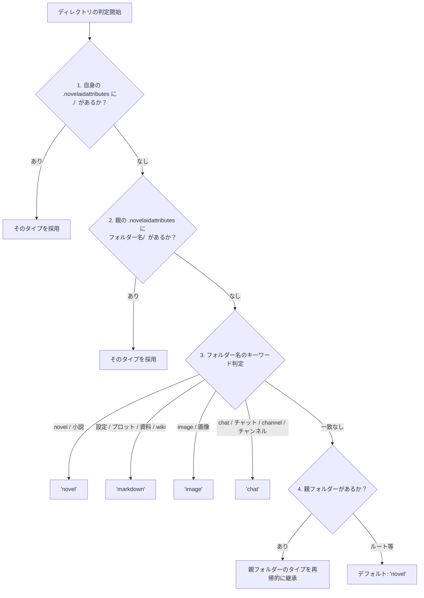

# ディレクトリ移動とフォルダー分類仕様書

本ドキュメントは、小説執筆補助CLIツール（`novelaid-cli`）における対話セッション中のディレクトリ移動機能（`/cd`）、一覧表示（`/ls`）、補完機能（Autocomplete）、および将来的なフォルダー・ファイル分類（DocumentType）の設計仕様書です。

---

## 1. 背景と設計方針

小説プロジェクトでは、巻・章・設定などの階層が任意に深く作成・管理されます。
そのため、特定の固定構造に依存せず、**通常のシェルのように階層を行き来できる柔軟性**と、**小説執筆に最適化されたスマートな移動支援**を両立させる必要があります。

### 設計の原則
1. **階層移動の自由度と安全性（ルート上限ガード）**:
   - `cd ..` や相対パスによる階層移動をサポートする。
   - ただし、プロジェクトルート（書庫ルート）より外側へは脱出できないよう制限する（サンドボックスの保護）。
2. **現在位置の可視化と一覧表示（`/pwd`, `/ls`）**:
   - 迷わず作業できるよう、現在位置（`/pwd`）と現在フォルダー内の一覧（`/ls`）を即座に確認可能にする。
3. **入力補完（Autocomplete）の提供**:
   - `/cd ` の入力時にサブフォルダーの候補を自動提示し、Tab補完を可能にする。
4. **段階的発展（`/cd` 基盤 ➔ 一覧・補完 ➔ DocumentType 分類 ➔ セマンティックコマンド）**:
   - 物理移動と閲覧・補完をまず固め、その後にフォルダー分類（`wiki`, `plot`, `novel`）へと発展させる。

---

## 2. ディレクトリ操作コマンド仕様

### 2.1 構文と動作一覧

| コマンド | 動作内容 |
|---|---|
| `/pwd` | 現在の作業フォルダー（相対パス・絶対パス・書庫ルート）を表示 |
| `/cd` | 引数なしの場合、プロジェクトルートへ即座に戻る |
| `/cd ..` | 1つ上の親ディレクトリへ移動（ルートにいる場合はルート上限ガードが発動して留まる） |
| `/cd <相対パス>` | 指定したパスへ移動（例: `/cd 10_novels`, `/cd 00_plot`） |
| `/ls [相対パス]` | 現在の作業フォルダー（または指定フォルダー）内のファイル・フォルダー一覧を表示 |

### 2.2 ルート上限ガード（Boundary Protection）
* ユーザーが `cd ../../../../` のように過度に親ディレクトリへ遡ろうとした場合、OSのエラーや書庫外への脱出を許さず、**プロジェクトルートで安全に停止**します。
* メッセージ例: `プロジェクトルートが上限です。外側へは移動できないため、ルート (novel/) に移動しました。`

### 2.3 作業フォルダー内の一覧表示（`/ls` / `/dir`）仕様
`/cd` で移動した直後や作業中に、現在地の中身を確認するためのスラッシュコマンドです。

* **構文**: `/ls [相対パス]`（エイリアス: `/dir`）
  - 引数なし: 現在の作業フォルダー内の一覧を表示。
  - 引数あり: 指定フォルダー内の一覧を表示。
* **表示仕様**:
  - フォルダー（`[DIR]`）を上部に優先配置。
  - ファイルは拡張子（`.txt` 原稿、`.md` 設定）やサイズを整理して表示。
  - 隠しファイル（`.git` 等）はデフォルトで除外。

### 2.4 Pi SDK 補完機能（Autocomplete）の調査結果と `/cd` 補完仕様
Pi Coding Agent SDK の内部調査により、以下の補完仕様が判明しました。

* **SDK標準ビルトイン補完**:
  - `/` 直後: 登録コマンド一覧が自動ポップアップ。
  - `@` 直後: プロジェクト内のファイル一覧が自動ポップアップ。
  - コマンド引数（`/cd ` の後ろ）: 標準ではファイル/パス補完は走らない。
* **拡張補完API（`ctx.ui.addAutocompleteProvider`）**:
  - SDKは拡張機能が独自の補完プロバイダーを多層スタック（Layering）できる公式APIを提供している。
  - 入力行のカーソル直前が `/cd ` で始まる場合、現在の作業フォルダー（`WorkspaceNavigator.getCurrentDir()`）配下のサブフォルダー一覧を動的にスキャンし、`AutocompleteSuggestions`（アイテム一覧）として返すことで、**TabキーやEnterによるフォルダー名自動補完**が公式に実現できる。

---

## 3. ドキュメントタイプ（`NovelaidDocumentType`）と `.novelaidattributes` 仕様

小説執筆環境（`novelaid-editor` / `novelaid-cli`）では、フォルダーやファイルが「小説原稿（novel）」なのか「設定・プロット等のマークダウン（markdown）」なのかを自動判定し、AIやエディターが執筆文脈を正しく解釈できるようにします。

本仕様は、先行プロダクト `novelaid-editor`（`src/novelaid-fs/main/FileService.ts`）で確立・実証された仕様と完全互換です。

### 3.1 ドキュメントタイプの定義（`NovelaidDocumentType`）
DOM標準の `DocumentType` との名称衝突を避けるため、型名は **`NovelaidDocumentType`** とします。

```typescript
export type NovelaidDocumentType =
  | 'novel'     // 小説本文・原稿（.txt、または .novelaidattributes で指定された .md）
  | 'markdown'  // 設定・プロット・資料等の汎用マークダウン（.md）
  | 'chat'      // チャットチャンネル（.ch）
  | 'image'     // 画像ファイル（.png, .jpg, .jpeg, .gif, .webp, .svg）
  | 'css'       // スタイルシート（.css）
  | 'gitDiff'   // Git差分
  | 'browser'   // ブラウザ表示
  | 'unknown';  // 未知・その他
```

### 3.2 ファイルのドキュメントタイプ判定（`getDocumentType`）

1. **拡張子による判定**:
   * `.txt` ➔ `'novel'`
   * `.ch` ➔ `'chat'`
   * `.css` ➔ `'css'`
   * `.png`, `.jpg`, `.jpeg`, `.gif`, `.webp`, `.svg` ➔ `'image'`
   * `.md`, `.markdown` 以外 ➔ `'unknown'`
2. **マークダウンファイル（`.md` / `.markdown`）の特殊判定**:
   * そのファイルが配置されているディレクトリ内の **`.novelaidattributes`** を確認（最優先）。
   * パターン（例: `*.md novel`, `第1話.md novel` 等）に一致した場合は、そのタイプを採用。
   * 特殊指定がない場合は、デフォルトで **`'markdown'`**（設定・資料）として扱う。

### 3.3 ディレクトリの優先ドキュメントタイプ判定（`getDirectoryType`）

フォルダーが「小説用」か「設定用」か「チャット用」かを判定する優先順位です。



1. **自身が配置された `.novelaidattributes` の `./` 指定**:
   * 例: `./ markdown` ➔ このフォルダー自身を markdown として扱う。
2. **親ディレクトリの `.novelaidattributes` の指定**:
   * 例: `10_novels/ novel`, `*wiki*/ markdown` ➔ パターンに一致するサブフォルダーのタイプを採用。
3. **フォルダー名に含まれるキーワード判定（大文字小文字不問）**:
   * **`novel`**: `novel`, `小説`
   * **`markdown`**: `設定`, `プロット`, `資料`, `wiki`
   * **`image`**: `image`, `画像`
   * **`chat`**: `chat`, `チャット`, `channel`, `チャンネル`
4. **親フォルダーからの継承**:
   * キーワードに該当しない中間フォルダー（例: `01_第1巻/`）は、親フォルダー（例: `10_novels/` ➔ `novel`）のタイプを再帰的に継承。
5. **フォールバック**:
   * ルート直下などで判別できない場合は、デフォルトで `'novel'`。

---

### 3.4 `.novelaidattributes` の仕様

#### 概要とスコープの原則
* **目的**: プロジェクト内のファイルやディレクトリのドキュメントタイプ（`NovelaidDocumentType`）を定義・上書きする。
* **非再帰の原則（局所性の保護）**:
  * Gitの `.gitattributes` と異なり、**簡易的な処理のみサポートし、再帰的な適用は行いません**。
  * 影響を及ぼすのは、**「同じディレクトリ内のファイル」および「直下のサブフォルダー」のみ** です。

#### 構文
空白区切りで `<パターン> <ドキュメントタイプ>` を指定します（`#` で始まる行と空行は無視）。

```text
# --- ファイルの指定 ---
*.txt novel
*.md markdown
小説.md novel

# --- 直下サブディレクトリの指定（末尾スラッシュ） ---
*novel*/ novel
*wiki*/ markdown
設定/ markdown

# --- このファイルが置かれているディレクトリ自身の指定 ---
./ markdown
```

#### パターンのマッチング規則
* 完全一致、またはワイルドカード（`*`: 任意の0文字以上、`?`: 任意の1文字）をサポート。
* 大文字・小文字は区別しない（case-insensitive）。

#### 誕生の背景（互換性対応）
* 作者が以前 Obsidian と併用していた経緯があり、小説原稿を `.md` で管理していました（現在は `.txt` への移行を推奨・進行中）。
* 「小説原稿フォルダー内の `.md` だけを `novel` として扱いたい」というケースに対応するため、該当フォルダーに `*.md novel` と書いた `.novelaidattributes` を置くだけで、設定用の `.md` と衝突せずに原稿として識別できるよう設計されています。

---

### 3.5 YAML Front Matter（メタデータ `tags`）との二層構造連携

ファイル種別が `markdown`（または `novel`）として識別された後、ファイル先頭の YAML Front Matter を解析してより詳細な役割（キャラクター、地名、プロット等）を識別します。

```markdown
---
name: アレン・クレスト
tags: [character, 主人公]
description: 本作の主人公。鑑定スキルを求める見習い魔導士。
---
```

* **登場人物**: `tags` に `character`, `登場人物`, `人物`, `chara` 等を含む。
* **地名・施設**: `tags` に `location`, `場所`, `地名`, `施設`, `places` 等を含む。
* **プロット・構成**: `tags` に `plot`, `プロット`, `構成`, `timeline`, `年表` 等を含む。

---

### 3.6 将来構想：セマンティックコマンドへの発展

分類情報に基づき、以下の直感的なショートカットコマンドを提供します。
* `/wiki`: 作品共通の設定フォルダー（`00_設定/` 等）へジャンプ
* `/plot`: 現在フォーカスしている作品のプロットフォルダーへジャンプ
* `/novel`: 現在の作品の原稿フォルダーへジャンプ

---

---

## 4. AIエージェントへの現在地・文脈伝達仕様（`before_agent_start`）

ユーザーが `/cd` や `/pwd` で作業フォルダーを移動・確認するだけでなく、**AIエージェント自身が「現在ユーザーがどのフォルダーにいて、何を書こうとしているのか（DocumentType）」を認識する**ための設計仕様です。

### 4.1 背景と設計方針：Pi SDKの二層ディレクトリ構造

* **Pi SDK 本体の基底 `cwd`**:
  - セッション起動時にプロジェクトルート（書庫ルート）に固定設定されます。
  - すべての組み込みツール（`read`, `write`, `bash` 等）は、プロジェクトルートを起点に安全に相対パスを解決します（親階層脱出の防止）。
* **`WorkspaceNavigator` の作業フォルダー（`currentDir`）**:
  - ユーザーが執筆作業を行っている「現在地（例: `10_novels/第1部`）」を内部で追跡します。
* **課題**:
  - Pi SDK 標準のシステムプロンプト内の `<cwd>` は書庫ルートのままであり、AIはユーザーが `/cd` で移動したことを自動的には知りません。
* **解決策**:
  - Pi SDK の公式フック **`before_agent_start`** を利用し、ユーザーが入力を送信してAIが思考・応答を開始する直前に、最新の「作業フォルダー」と「ドキュメントタイプ（`NovelaidDocumentType`）」をプロンプトセクションとして動的注入します。

### 4.2 動的注入セクション（`<novelaid_workspace>`）の仕様

`api.on("before_agent_start", (event, ctx) => { ... })` において、`event.systemPromptOptions.sections["novelaid_workspace"]` に以下の構造化情報を注入します。

```xml
<novelaid_workspace>
- Active Directory: [10_novels/第1部]
- Document Type: novel
- Working Scope Rule: When the user specifies a file name without an explicit path (e.g., "第1話.txt"), look in Active Directory first.
- Context Persona: The current workspace is for novel manuscript. Focus on literary expression, dialogue, narration, and style.
</novelaid_workspace>
```

#### ドキュメントタイプ別の役割（Context Persona）ガイドライン
| DocumentType | 主な役割・ガイドライン |
|---|---|
| `novel` | **小説本文執筆・校正モード**: 地の文やセリフの描写、文体リズム、表現力、情景描写に注力する。 |
| `markdown` | **設定考案・プロット構成モード**: 設定の整合性、起承転結、伏線、年表等の論理的整理に注力する。 |
| `chat` | **アイデア出し・ブレインストーミングモード**: 自由な発想での対話、壁打ち、雑談ブレインダンプに注力する。 |
| その他 (`general`) | **総合支援モード**: プロジェクト全体の構造や一般的な執筆支援を行う。 |

---

## 5. 開発計画（実装ステップ）

1. **Step 3-2: `/cd`（階層移動・現在位置表示・ルート上限ガード）の実装（✔ 完了）**:
   - `src/workspace/navigator.ts`: 現在位置管理、相対パス解決、ルート上限ガード。
   - `src/extensions/novelaid.ts`: `/cd` および `/pwd` コマンドの実装・単体テスト完了。
2. **Step 3-2a: 作業フォルダー内一覧表示コマンド（`/ls` / `/dir`）の実装（✔ 完了）**:
   - `listEntries()` によるフォルダー優先一覧表示、ファイルサイズ整形、隠しファイル除外。
3. **Step 3-2b: `/cd` 引数に対するフォルダー補完（`addAutocompleteProvider`）の実装（✔ 完了）**:
   - Pi SDK 公式拡張 API による動的 Tab 補完の実装と単体テスト（全14ケース合格）。
4. **Step 3-3: DocumentType によるフォルダー・ファイル自動分類（✔ 完了）**:
   - `src/workspace/types.ts`: `NovelaidDocumentType` 型定義の作成。
   - `src/workspace/attributes.ts`: `.novelaidattributes` パーサー、ワイルドカード照合、キャッシュ機構の実装。
   - `src/workspace/navigator.ts`: `getDocumentType`（ファイル種別判定）および `getDirectoryType`（フォルダー種別判定）の実装。
   - `src/workspace/frontmatter.ts`: Front Matter メタデータ（`tags`）抽出の実装。
   - 単体テスト（`scratch/test-document-type.mjs`）による全件合格検証。
5. **Step 3-3b: 現在地およびDocumentTypeのAIコンテキスト動的注入（✔ 完了）**:
   - `before_agent_start` イベントによる `<novelaid_workspace>` セクション動的注入の実装。
   - `/pwd` コマンドでのフォルダー種別（DocumentType）表示の統合。
   - ドキュメントタイプ別執筆ペルソナ（`getPersonaGuideline`）の定義。
   - 単体テスト（`scratch/test-workspace-prompt.mjs`）による全件合格検証。
6. **Step 3-4: セマンティックショートカット（`/wiki`, `/plot`, `/novel`）の実装（← 次の着手対象）**:
   - 分類情報を用いたクイックジャンプコマンドの提供。

