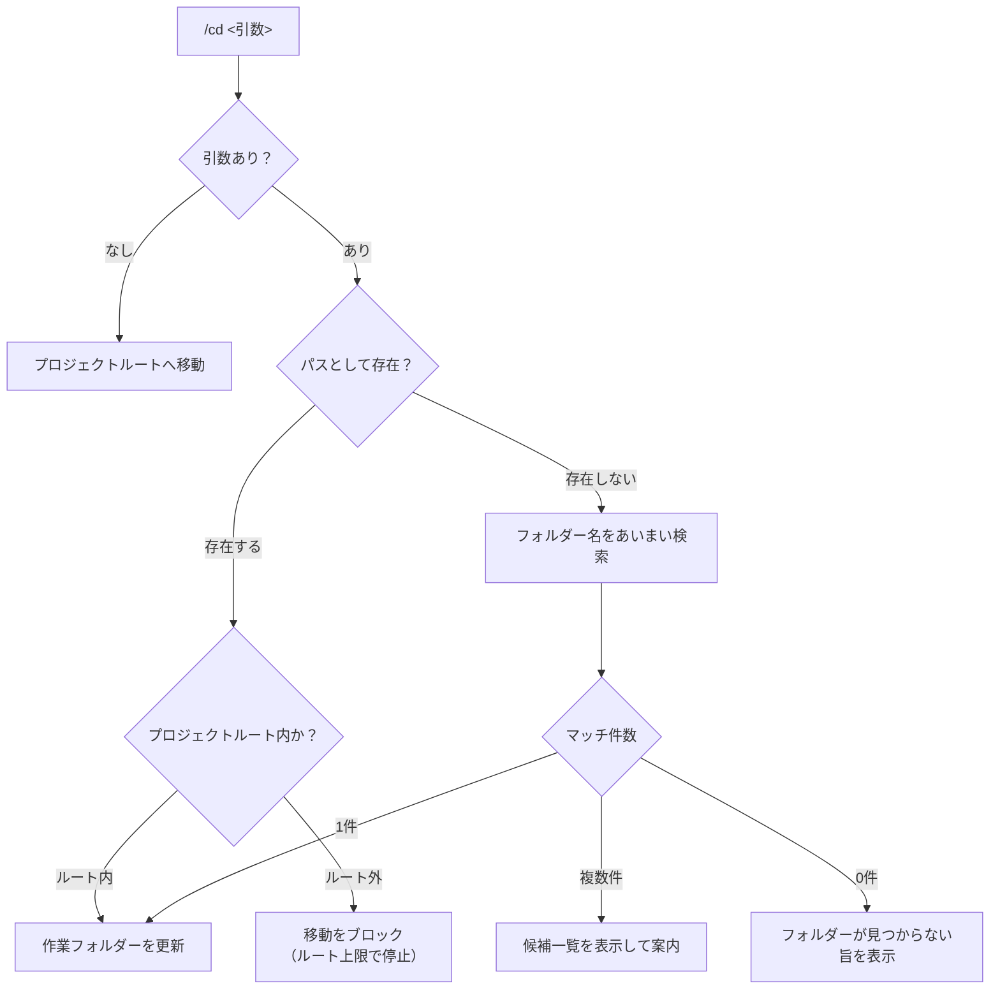

# ディレクトリ移動とフォルダー分類仕様書

本ドキュメントは、小説執筆補助CLIツール（`novelaid-cli`）における対話セッション中のディレクトリ移動機能（`/cd`）および将来的なフォルダー・ファイル分類（DocumentType）の設計仕様書です。

---

## 1. 背景と設計方針

小説プロジェクトでは、巻・章・設定などの階層が任意に深く作成・管理されます。
そのため、特定の固定構造に依存せず、**通常のシェルのように階層を行き来できる柔軟性**と、**小説執筆に最適化されたスマートな移動支援**を両立させる必要があります。

### 設計の3原則
1. **階層移動の自由度と安全性（ルート上限ガード）**:
   - `cd ..` や相対パスによる階層移動をサポートする。
   - ただし、プロジェクトルート（書庫ルート）より外側へは脱出できないよう制限する（サンドボックスの保護）。
2. **あいまい検索（Fuzzy Search）によるクイック移動**:
   - パスをフル入力しなくても、フォルダー名の一部（例: `/cd 鑑定` や `/cd plot`）で目的のフォルダーへ移動できる。
3. **段階的発展（`/cd` 基盤 ➔ DocumentType 分類 ➔ セマンティックコマンド）**:
   - 最低限必須かつ普遍的な `/cd` を第一歩として実装。
   - その後、フォルダーの分類機能（`wiki/setting`, `plot`, `novel/episode`）を整備し、セマンティックな専用コマンドへ発展させる。

---

## 2. `/cd` コマンド仕様

### 2.1 構文と動作パターン

| 入力例 | 動作内容 |
|---|---|
| `/pwd` | 現在の作業フォルダー（プロジェクトルートからの相対パス）を表示 |
| `/cd` | 引数なしの場合、プロジェクトルートへ即座に戻る |
| `/cd ..` | 1つ上の親ディレクトリへ移動（ルートにいる場合はルートに留まる） |
| `/cd <相対パス>` | 指定したパスへ移動（例: `/cd 00_plot`, `/cd ../02_外伝`） |
| `/cd <キーワード>` | パスが存在しない場合、フォルダー名をあいまい検索して該当フォルダーへ移動（例: `/cd 鑑定` ➔ `10_novels/01_僕は鑑定が使いたい`） |

### 2.2 移動処理フロー

### 2.3 ルート上限ガード（Boundary Protection）
* ユーザーが `cd ../../../../` のように過度に親ディレクトリへ遡ろうとした場合、OSのエラーや書庫外への脱出を許さず、**プロジェクトルートで安全に停止**します。
* メッセージ例: `プロジェクトルート (novel/) に到達しました。これ以上上の階層へは移動できません。`

---

## 3. 将来構想：フォルダー分類（DocumentType）とセマンティック移動

`/cd` による物理的な移動基盤が整った後、フォルダーやファイルに「意味（役割）」を持たせる分類機能を導入します。

### 3.1 意味を持つ分類カテゴリ

| カテゴリ名 | 役割・内容 | 例 | 備考 |
|---|---|---|---|
| **`wiki`** | 全体共通の設定・世界観・登場人物・用語集 | `00_設定/`, `wiki/` | `setting` はCLI設定コマンドと衝突しやすいため `wiki` を推奨 |
| **`plot`** | 企画書、全体構成、各章のプロット | `00_plot/`, `plot/` | 章単位や作品単位で配置される |
| **`novel`** | 本編原稿、パイロット版テキスト | `10_novels/`, 各話原稿 | `episode` と呼称する場合もある |

### 3.2 セマンティックコマンドへの発展
分類機能が有効になった段階で、以下の直感的なショートカットを提供します。
* `/wiki`: 現在の作品または共通の `wiki`（設定）フォルダーへジャンプ
* `/plot`: 現在フォーカスしている作品の `plot` フォルダーへジャンプ
* `/novel`: 現在の作品の原稿フォルダーへジャンプ

---

## 4. 開発計画（実装ステップ）

1. **Step 3-2: `/cd`（階層移動・あいまい検索・ルート上限ガード）の実装**:
   - `src/workspace/navigator.ts`: 現在位置管理、相対パス解決、ルート上限バリデーション、あいまい検索ロジック。
   - `src/extensions/novelaid.ts`: `/cd` および `/pwd` スラッシュコマンドの登録。
   - 動作確認: `cd ..`, `cd 相対パス`, `cd あいまい検索`, ルート上限ガードのテスト。
2. **Step 3-3: DocumentType によるフォルダー・ファイル自動分類**:
   - フォルダー構造・ファイル名・Front Matterに基づく分類（`wiki`, `plot`, `novel`）エンジンの実装。
3. **Step 3-4: セマンティックショートカット（`/wiki`, `/plot`, `/novel`）の実装**:
   - 分類情報を用いたクイックジャンプコマンドの提供。
