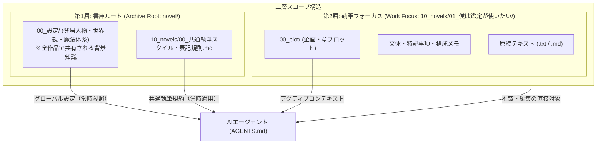
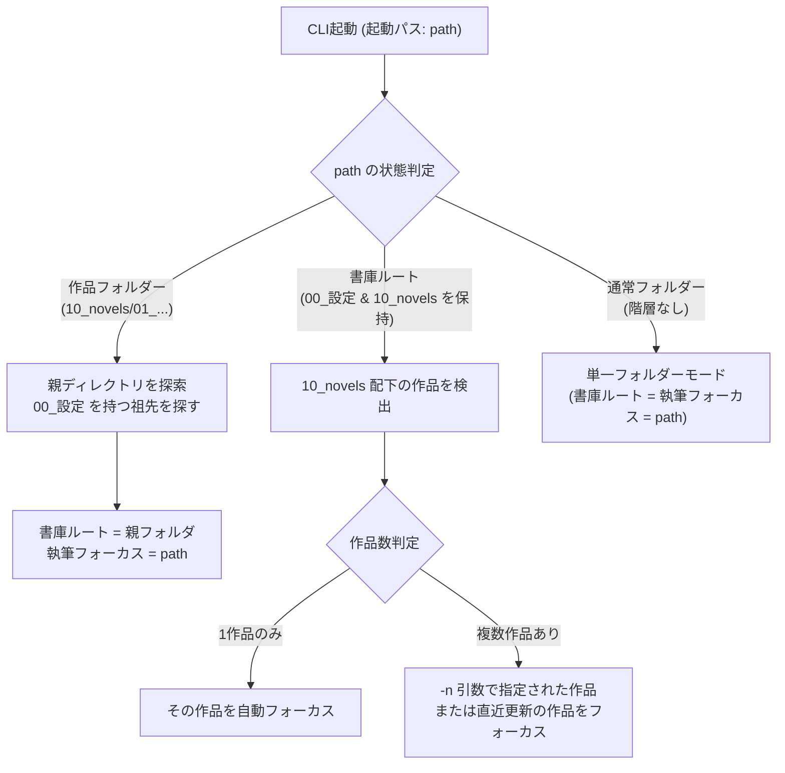

# 作品フォルダー管理と二層スコープ仕様書

本ドキュメントは、小説執筆補助CLIツール（`novelaid-cli`）における「フォルダー単位のプロジェクト管理」および「二層スコープ（書庫ルート ＋ 執筆フォーカス）」の設計仕様書です。

---

## 1. 背景と課題

小説の執筆現場においては、以下のようなフォルダー構造が一般的です。

```text
novel/                             ← 書庫ルート（全作品共通）
│  README.md
├─00_設定/                          ← 共通設定（全作品で共有）
│  ├─登場人物/                       ← アレン、セリア等のキャラクター設定
│  └─設定/                          ← 世界観、法則・体系、用語、組織・社会
├─10_novels/                       ← 小説群
│  │  00_共通執筆スタイル・表記規則.md
│  │  小説一覧.md
│  └─01_僕は鑑定が使いたい/          ← 個別作品フォルダー（執筆フォーカス）
│      │  00_pilot_...md
│      └─00_plot/                  ← 企画・全体プロット、章プロット
└─making/                          ← メイキング、開発計画、ログ
```

### 従来の単一ルート管理の課題
1. **同名ファイルの衝突**: 複数作品を執筆する場合、作品ごとに `01_第1章プロット.md` や `01_第1話.txt` が存在するため、単一のルートでは「どの作品の第1章か」が特定できない。
2. **スコープの孤立**: 作品フォルダー（`01_僕は鑑定が使いたい`）だけを独立して開いてしまうと、上位にある `00_設定/`（登場人物や世界観）が見えなくなる。
3. **コンテキストの肥大化**: 全作品の全プロットを一度にAIに渡すと、コンテキスト窓を圧迫し、ハルシネーション（別作品の設定の混入）を引き起こす。

---

## 2. 二層スコープアーキテクチャ

`novelaid-cli` では、**「書庫ルート（Archive Root）」** と **「執筆フォーカス（Work Focus）」** の二重スコープ構造を採用します。



### 第1層：書庫ルート（Archive Root）
* **役割**: 作品ユニバース全体の共有設定やルールを保持する。
* **主要コンテンツ**:
  - `00_設定/登場人物/`: キャラクターシート、相関図
  - `00_設定/設定/`: 世界観、法則・体系（魔法、スキル）、用語集、組織・社会
  - `10_novels/00_共通執筆スタイル・表記規則.md`: 全体共通の文体ルール
  - `10_novels/小説一覧.md`: 作品インデックス

### 第2層：執筆フォーカス（Work Focus）
* **役割**: 現在作家が執筆・推敲・相談している「特定の1作品」に集中する。
* **主要コンテンツ**:
  - `00_plot/`: 企画案、全体プロット、章ごとのプロット
  - 作品固有の特記事項・文体メモ
  - 各章・各話の原稿ファイル（`.txt` または `.md`）
* **効果**: ファイル名（`01_第1章プロット.md` 等）の曖昧性が解消され、AIが確実に該当作品の文脈で作業できる。

---

## 3. 自動探索・解決ロジック（WorkspaceResolver）

起動時に、ユーザーがどこでCLIを実行しても自動的に「書庫ルート」と「執筆フォーカス」を特定します。



### 探索アルゴリズム
1. **親階層探索（Bubble-up Search）**:
   - カレントディレクトリから上に向かって `00_設定/` または `novelaid.json` が存在するディレクトリを探索。
   - 見つかった場合、そのディレクトリを **書庫ルート**、起動ディレクトリが `10_novels/` 配下であればそれを **執筆フォーカス** とする。
2. **境界チェック（サンドボックス保護）**:
   - 探索された「書庫ルート」より外側の親ディレクトリ（`../../..` 等）へのアクセスは一切行わない。

---

## 4. Front Matter メタデータ仕様

設定資料およびプロットファイルは、Markdown の YAML Front Matter によるメタデータを付与して管理します。
Pi SDK 内蔵の `parseFrontmatter` を用いて高速にパースし、タグや種別による柔軟なフィルタリングを行います。

### 4.1 キャラクター設定（例: `00_設定/登場人物/アレン・クレスト.md`）
```markdown
---
type: character
id: allen-crest
name: アレン・クレスト
ruby: あれん・くれすと
role: 主人公
status: active
tags: [学園生, 鑑定士, 転生者]
importance: main
---
# アレン・クレスト
ここに詳細な設定テキスト...
```

### 4.2 世界観・法則設定（例: `00_設定/設定/法則・体系/魔力と魔法適性.md`）
```markdown
---
type: setting
category: magic_system
title: 魔力と魔法適性
tags: [魔法体系, 設定, バトル]
summary: 本世界における属性適性と魔力循環の基本法則
---
# 魔力と魔法適性
...
```

### 4.3 プロット（例: `10_novels/01_.../00_plot/01_第1章プロット.md`）
```markdown
---
type: plot
work: 01_僕は鑑定が使いたい
chapter: 1
title: 学園入学と適性鑑定の波乱
status: drafting
target_words: 8000
characters: [allen-crest, celia-el-fermina]
---
# 第1章プロット
...
```

---

## 5. コマンド・CLIインターフェース

### 5.1 起動時オプション
```powershell
# 1. 現在地から自動検出（通常起動）
novelaid

# 2. パスを指定して起動
novelaid novel/10_novels/01_僕は鑑定が使いたい

# 3. 書庫ルートから作品名を明示して起動
novelaid novel -n "01_僕は鑑定が使いたい"
novelaid --project novel --novel "01_僕は鑑定が使いたい"
```

### 5.2 対話TUIセッション内の専用コマンド
Pi SDK の `InlineExtension` を通じて以下のスラッシュコマンドを提供します。

| コマンド | 説明 |
|---|---|
| `/novel` | 現在の二層スコープ（書庫ルートおよびフォーカス中の作品情報）を表示 |
| `/novel list` | 書庫内の利用可能な小説作品一覧を表示 |
| `/novel <作品名>` | 対話を維持したまま、フォーカス対象の作品を即座に切り替え |
| `/ctx` | 現在のコンテキスト（読み込まれている共通設定およびプロット）の一覧表示 |

---

## 6. 実装計画

1. **モジュール作成 (`src/workspace/`)**:
   - `types.ts`: `WorkspaceScope`, `NovelWork`, `FrontmatterMetadata` 型定義。
   - `resolver.ts`: 親ディレクトリ遡り探索と作品フォルダー解決を行う `resolveWorkspaceScope()`。
   - `frontmatter.ts`: Pi SDKの `parseFrontmatter` をラップしたメタデータ抽出関数。
2. **CLIエントリーポイント統合 (`src/cli.ts`)**:
   - 起動引数（`-p / --project`, `-n / --novel`, `[path]`）の解釈とスコープ確定。
3. **InlineExtension連携 (`src/extensions/novelaid.ts`)**:
   - `/novel` コマンドの登録と、確定したスコープのコンテキスト注入。
