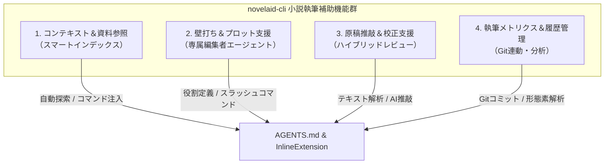
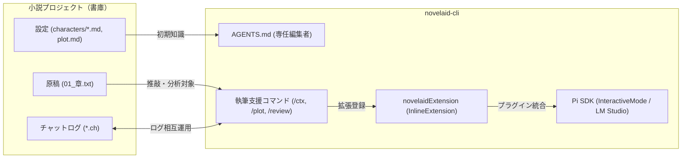

# 小説執筆補助機能 検討・計画書

本ドキュメントは、小説執筆補助CLIツール（`novelaid-cli`）において提供すべき小説執筆支援機能を検討し、実装フェーズおよびアーキテクチャを定義する計画書です。
デスクトップ版エディタ [`novelaid-editor`](../novelaid-editor) の設計思想や仕様を継承・連携しつつ、CLI（ターミナル環境およびPi Coding Agent SDK）の強みを最大限に活かした機能群を整理します。

---

## 1. novelaid-editor からの知見と継承すべき設計思想

デスクトップ版 `novelaid-editor`（および `novelaid-editor-docs`）の調査より、以下の執筆支援思想を `novelaid-cli` に継承します。

### 1.1 ドキュメントとフォルダーの二重構造
* **小説本文（`.txt`）**: 原稿はプレーンなテキストファイル（章・話数ごと）で管理。
* **設定資料（`.md`）**: キャラクター表、世界観設定、用語集、プロット等は Markdown で管理。
* **対話ログ（`.ch`）**: AIとの壁打ち記録（チャットチャンネル）をファイルとして永続化。

### 1.2 高度なコンテキスト制御
* 全文を一括でAIに渡すのではなく、**「いま執筆・推敲している原稿」＋「関連するキャラクター設定」＋「該当章のプロット」** をピンポイントで組み合わせることで、モデルのコンテキスト窓を圧迫せず、ハルシネーション（設定のブレ）を防ぐ。

### 1.3 多面的な推敲・校正
* **ルールベース校正**: `textlint` や形態素解析（助詞の連続、ら抜き言葉、漢字の開き、約物の全角半角ルール）。
* **AI文体推敲**: 描写の解像度向上、リズム感、視点（POV）の整合性チェック。

---

## 2. 小説執筆補助機能の一覧と検討（CLIならではの機能案）

ターミナル環境（CLI）および Pi Coding Agent SDK のエコシステム（`InteractiveMode` / `ExtensionAPI` / `AGENTS.md` / `Skills`）を活かし、以下の4カテゴリ・計12機能を提案・計画します。

---

### カテゴリ 1: コンテキスト＆設定資料管理（資料連携）

| 機能名 | コマンド / 形式 | 概要・詳細 |
|---|---|---|
| **1. 設定資料の自動検知・読み込み** | `AGENTS.md` 自動連携 | ワークスペース内の `settings/` や `characters/`、`plot.md` 等を走査し、作品の基本コンテキストをAIの初期知識として自動インジェクション。 |
| **2. クイックコンテキスト追加** | `/ctx [ファイル名\|キーワード]` | 指定した設定ファイルや前章の原稿を、そのターンの会話コンテキストに即座に追加・解除できる。 |
| **3. 設定検索（ナレッジ参照）** | `/find [キーワード]` | 「このキャラの誕生日は？」「この魔法の詠唱制限は？」など、設定資料群から該当箇所を高速検索して要約提示。 |

---

### カテゴリ 2: 壁打ち＆創作支援（エージェント・ペルソナ）

| 機能名 | コマンド / 形式 | 概要・詳細 |
|---|---|---|
| **4. 専属編集者ペルソナ（AGENTS.md）** | 常時（対話UI） | 小説の作法（起承転結、三幕構成、テンポ、読者感情誘導）を熟知した壁打ちパートナーとして応答。褒めてモチベーションを高めつつ、矛盾点を建設的に指摘。 |
| **5. プロット・展開シミュレーター** | `/plot [相談内容]` | 「ここで裏切りを入れたい」「第4話のピンチを脱出する案を3つ出して」など、展開案・選択肢のブレインストーミング。 |
| **6. キャラクターなりきり対話** | `/role [キャラ名]` | AIが作中の特定キャラクターになりきって作家と対話。「このセリフ、あなたなら何て言う？」など、セリフや行動のブレを口調も含めて検証。 |
| **7. 対話ログ永続化（.ch 互換）** | `/save-chat [タイトル]` | AIとの壁打ち結果を `novelaid-editor` 互換の `.ch` または Markdown 形式で保存し、後から読み返せるようにする。 |

---

### カテゴリ 3: 推敲＆校正支援（ハイブリッド校正）

| 機能名 | コマンド / 形式 | 概要・詳細 |
|---|---|---|
| **8. 文章レビュー・推敲提案** | `/review [ファイル名] [範囲]` | 原稿の文章表現を推敲。「五感（視覚・聴覚・触覚・嗅覚・味覚）描写の補強」「説明過多（Show, don't tell）の解消」「文末（〜た。〜た。）の連続回避」を指摘・リライト案提示。 |
| **9. 視点（POV）・時系列チェック** | `/check-pov [ファイル名]` | 一人称視点なのに主人公の知らないはずの心理が書かれていないか（神の視点の混入）、時間の前後関係に矛盾がないかを精査。 |
| **10. 形式校正（textlint連携）** | `/proofread [ファイル名]` | ら抜き言葉、助詞の過度な重複、漢字の開き（「こと/事」「とき/時」）、約物ルールの違反をルールベースで厳密かつ高速に検出。 |

---

### カテゴリ 4: 執筆進捗＆メトリクス分析（CLI支援）

| 機能名 | コマンド / 形式 | 概要・詳細 |
|---|---|---|
| **11. 原稿統計・メトリクス表示** | `/stats [ファイル名]` | 文字数、原稿用紙換算枚数、読了予想時間（分）、会話文率（セリフ比率）、漢字含有率を算出・可視化。 |
| **12. 執筆スナップショット（Git連動）** | `/snapshot [コメント]` | 「第3章の大幅改稿前」など、ワンコマンドでGitのコミットやタグを作成し、安心して試行錯誤できる環境を提供。 |

---

## 3. 実装ロードマップ（フェーズ分け）

| フェーズ | 対象機能 | 開発内容 |
|---|---|---|
| **Phase 1: 基礎コンテキスト確立（Step 3-1）** | 機能 1, 4 | 小説執筆特化の `AGENTS.md` 設計。プロジェクト内の設定ファイル自動認識とシステムプロンプト確立。 |
| **Phase 2: 創作支援スラッシュコマンド（Step 3-2）** | 機能 2, 5, 6, 11 | `InlineExtension` による小説専用コマンド（`/ctx`, `/plot`, `/role`, `/stats`）の実装。 |
| **Phase 3: 推敲・校正エンジンの統合（Step 3-3）** | 機能 8, 9, 10 | 原稿ファイルの読み込み・差分推敲プロンプト（`/review`）およびルールベース校正の実装。 |
| **Phase 4: 相互運用＆履歴管理（Step 3-4）** | 機能 7, 12 | `novelaid-editor` 連携（`.ch` 形式ログ保存）およびGitスナップショット機能の実装。 |

---

## 4. アーキテクチャ連携図

