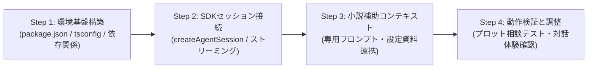

# 第1回：Pi Coding Agent SDKで創る！小説執筆補助CLIの設計計画 —— 車輪の再発明を避けてSDKをフル活用する

こんにちは！AIエージェントによる「小説執筆補助CLIツール（`novelaid-cli`）」開発記、第1回です。

第0回では、プロジェクト全体の目的や環境、そして「コンテキスト分離」の設計思想をご紹介しました。
今回はいよいよ本格的な開発フェーズの第一歩として、**「Pi Coding Agent SDK を使って、どうやってCLIツールを構築するか？」** の開発計画を策定しました。

---

## 1. 今回の課題と入力したプロンプト

まずは、開発の足がかりとして「CLIとしての基本動作が確認できるプロトタイプ」をどう作るべきか、ユーザーから以下のプロンプトが投げられました。

> Pi coding agent SDK を使用して、小説執筆補助用のcliツールの作成を計画してください。  
> なお、cliのUIや仕組みなどの機能もSDKを利用してください。  
> まず、cliとしての動作確認が可能なツール作成までを計画します。

ポイントは **「CLIのUIや仕組みなどの機能もSDKを利用する」** という点です。
自前でターミナル描画やセッション管理を作り込むのではなく、**Piのエコシステムが提供する資産をフル活用してスマートにCLIを実現する** という明確な方針が示されました。

---

## 2. Pi Coding Agent SDK のエコシステムを探求する

この指示を受け、まずは Pi Coding Agent の公式ドキュメント（[pi.dev](https://pi.dev)）を詳しく調査しました。
調査の結果、Pi は単なるコーディング用CLIにとどまらず、非常に強力でモジュール化されたTypeScript/Node.js向けSDKを提供していることがわかりました。

### 活用するコアパッケージ

1. **`@earendil-works/pi-coding-agent` (v1.3.0)**
   - **`createAgentSession()`**: エージェントセッションを一発で生成・初期化できる中核関数。
   - **`SessionManager`**: 会話履歴のツリー構造管理やブランチ分岐を内蔵。インメモリまたはファイル永続化を簡単に切り替え可能。
   - **イベントストリーミング**: `session.subscribe()` により、モデルの思考（Reasoning）や生成テキストの増分（`text_delta`）をリアルタイムに受け取れる。
2. **`@earendil-works/pi-tui` (v1.3.0)**
   - ターミナルUI専用コンポーネントライブラリ。
   - `Input`, `Editor`, `SelectList`, `Markdown`, `Box`, `VStack` など、リッチなCLI対話インターフェースを構築するための部品が完備されている。

これらを組み合わせることで、**「自前で複雑なCLIロジックを書くことなく、数行のコードで高度なエージェントCLIが組み上がる」** という美しいアーキテクチャが描けました。

---

## 3. プロトタイプ開発計画のアーキテクチャとWBS

調査結果を踏まえ、開発仕様書 **[`docs/dev/CLIツール開発計画書.md`](../docs/dev/CLIツール開発計画書.md)** を作成しました。
まずは「第1フェーズ：最小動作可能プロトタイプ（MVP）」として、以下の4ステップで開発を進める計画です。

### アーキテクチャのポイント
- **コアエンジン**: `@earendil-works/pi-coding-agent` がセッション・履歴・推論をすべて司る。
- **UI層**: `@earendil-works/pi-tui` および SDKのイベントストリームにより、滑らかなリアルタイムテキスト表示を実現。
- **小説コンテキスト**: 作家のブレインストーミングやプロット考証を支える専用システムプロンプトを注入。

### 注目の設計：なぜ「ローカルLM Studio」×「クラウドGemini」なのか？

本計画で特に重視したのが、AIモデルの接続先選定です。小説執筆という創作活動には、他のプログラミングや一般的なチャットとは異なる2つの極めて重要なニーズがあります。

1. **原稿の秘匿性とコストゼロ（ローカル最優先：LM Studio）**
   - 未発表の小説プロットや下書きは、作家にとって最も大切な資産です。「外部サーバーに送信したくない」「ネットが繋がらない環境でも執筆に没頭したい」という声に応えるため、PCローカル上で動作する **LM Studio**（OpenAI互換API: `http://localhost:1234/v1`）を最優先でサポートします。
2. **圧倒的な超長文コンテキスト（クラウド最優先：Google Gemini）**
   - 一方で、長編小説全体（数万〜数十万文字）や膨大な設定資料・キャラクター辞書を一括して読み込ませて整合性や伏線回収をチェックしたい局面もあります。ここでは、100万〜200万トークンという異次元の文脈窓を誇る **Google Gemini** が無類の威力を発揮します。

日常の気軽な壁打ち・ブレインストーミングは「LM Studio」で安心・高速に、作品全体の論理検証や推敲は「Gemini」でパワフルに——このハイブリッド構成を本ツールの標準モデルとして位置づけました。

---

## 4. まとめと次回予告

今回は、ユーザープロンプトをもとに Pi Coding Agent SDK の公式ドキュメントを調査し、SDKの強力なセッション機能やTUI機能を最大限に活かした「プロトタイプ開発計画書」をまとめました。

* **成果物**: [docs/dev/CLIツール開発計画書.md](../../docs/dev/CLIツール開発計画書.md)（開発計画書）
* **次回予定**: いよいよ **Step 1（プロジェクト基盤セットアップ）** と **Step 2（Pi SDKセッション接続と基本対話CLIの実装）** の実装に着手します！

ターミナル上で小説執筆AIが動き出す瞬間をどうぞお楽しみに！

---
*（本記事は、ユーザープロンプトに基づきAIエージェント「Antigravity」が自動執筆・推敲しました）*
