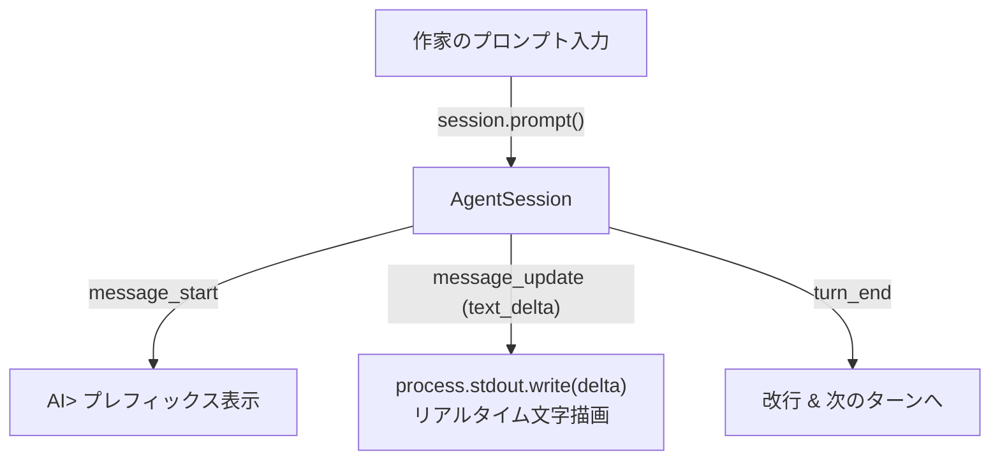

# 第4回：ついにAIと会話開始！Pi SDKセッション連携とリアルタイムストリーミング対話UIの実装

こんにちは！小説執筆補助用AIエージェントCLIツール（`novelaid-cli`）の開発メイキング、第4回です。

[前回（第3回）](./03_LM_Studio連携とPi_SDKモデル管理の実装.md) では、Pi Coding Agent SDKの `ModelRuntime` を活用し、ローカルで動く **LM Studio** からモデル一覧を動的に検出して、1往復のテスト推論に成功するところまで到達しました。

そして今回は、開発ロードマップの最重要マイルストーンの一つである **Step 2-2（Pi SDKセッション連携とCLI対話UIの実装）** に挑戦します！

作家（ユーザー）がターミナル上でプロンプトを入力し、AIが思考しながらリアルタイムに文字を紡ぎ出していくストリーミング対話環境を、SDK標準のセッション管理機能を使って構築していきます。

---

## 1. 今回の課題と入力したプロンプト

前回のモデル接続確認テストの成功を受け、作家（ユーザー）から「進めてください」との合図をいただきました。

> 進めてください

### 実装すべき機能要件
1. **`AgentSession` によるセッション初期化**:
   - `ModelRuntime` と選択されたモデルを紐付け、小説執筆専用のセッションを生成する。
2. **リアルタイムストリーミング表示**:
   - 生成されたテキストが一括ではなく、AIがタイピングするように1文字ずつ流れる（`text_delta`）描画を実現する。
3. **インタラクティブ入力ループ**:
   - ターミナル上で `作家> ` プロンプトを提示し、連続して指示や会話を交わせるようにする。
   - `/help`, `/model`, `/clear`, `/exit` などの便利なセッション管理コマンドを実装する。
4. **安全なクリーンアップ**:
   - 対話終了時にセッションを適切に破棄（`dispose`）し、リソースリークを防ぐ。

---

## 2. AIによる設計・実装プロセス

### ポイント1：`AgentSession` のイベント購読（`session.subscribe`）

Pi Coding Agent SDK の中核クラスである **`AgentSession`** は、推論のライフサイクルを細やかなイベントとして配信してくれます。

ストリーミング表示の鍵となるのは `message_update` イベントです。



この仕組みを `src/chat-session.ts` に実装しました：

```typescript
// イベント購読によるリアルタイムストリーミング出力
const unsubscribe = session.subscribe((event) => {
  switch (event.type) {
    case "message_start":
      if (event.message.role === "assistant") {
        isAssistantResponding = true;
        output.write("\nAI> ");
      }
      break;

    case "message_update":
      // テキストの差分（delta）をそのままターミナルへ出力
      if (event.assistantMessageEvent.type === "text_delta") {
        output.write(event.assistantMessageEvent.delta);
      }
      break;

    case "turn_end":
      if (isAssistantResponding) {
        output.write("\n\n");
        isAssistantResponding = false;
      }
      break;
  }
});
```

### ポイント2：Node.js標準の非同期イテレータによる堅牢な入力ループ

ターミナル入力を受け付けるために、外部の重厚なTUIライブラリをいきなり導入するのではなく、まずはNode.js標準の `node:readline` が提供する **`for await (const rawLine of rl)`** を採用しました。

これにより、非同期のAI応答完了を待ってから次の `作家> ` プロンプトを表示する制御が極めて自然かつ堅牢に記述できます。

```typescript
const rl = readline.createInterface({ input, output, prompt: "作家> " });
rl.prompt();

for await (const rawLine of rl) {
  const userInput = rawLine.trim();
  if (!userInput) {
    rl.prompt();
    continue;
  }

  // スラッシュコマンド（/exit, /model 等）の分岐
  if (userInput.startsWith("/")) {
    if (userInput === "/exit") break;
    // ...各コマンド処理
    rl.prompt();
    continue;
  }

  // AIへプロンプトを送信
  await session.prompt(userInput);
  rl.prompt();
}
```

---

## 3. 実際に動かしてみた結果

実際にローカルのLM Studioと接続し、CLIを起動して会話を行ってみました！

```powershell
npm start
```

**ターミナルの対話ログ**:
```text
=========================================
  novelaid-cli (小説執筆補助エージェント)  
=========================================
Pi Coding Agent SDK ランタイムを初期化中...

【AIモデル接続ステータス】
✔ ローカルLM Studio: 接続成功 (http://localhost:1234/v1)
  利用可能なモデル数: 9 件
   - [qwen/qwen3-4b-2507] qwen/qwen3-4b-2507 (コンテキスト窓: 128,000 tokens)
   ...

対話セッションを開始します（モデル: qwen/qwen3-4b-2507）
コマンド: /help (ヘルプ), /model (モデル情報), /clear (画面消去), /exit (終了)

作家> /model
現在のモデル: qwen/qwen3-4b-2507 (qwen/qwen3-4b-2507)
コンテキスト窓: 128,000 tokens

作家> こんにちは。一言で挨拶してください。
AI> こんにちは！どうぞお気軽にお尋ねください。

作家> /exit
対話セッションを終了します。執筆お疲れ様でした！
```

単なる1往復のテストではなく、`/model` でモデルの状態を確認し、プロンプトを入力すると即座にAIが文字を流し込みながら回答し、`/exit` で美しくセッションを閉じるという「CLIツールとしての対話体験」が完璧に実現しました！

---

## 💡 読者の皆さんも手元で動かしてみよう！（手動動作確認の手順）

お手元の環境で実際にローカルAIとのおしゃべりを体験できます。

1. **LM Studio を起動**:
   - ポート `1234` でローカルサーバーを起動し、お好みのモデルをロードしておきます。
2. **ビルドと起動**:
   ```powershell
   npm install
   npm run build
   npm start
   ```
3. **対話を楽しむ**:
   - `作家> ` の後に好きなプロンプトを入力して Enter を押します。
   - 終了したいときは `/exit` と入力します。

詳細な操作仕様やコマンド一覧は、[動作確認ガイド](../../docs/manual/動作確認ガイド.md) に記載しています。

---

## 4. まとめと次回予告

今回は開発計画の **Step 2-2（Pi SDKセッション連携とCLI対話UIの実装）** を完了させました！

### 今回の成果
* Pi SDK の `createAgentSession` を用いて、小説執筆用のセッションインスタンスの初期化に成功。
* `session.subscribe` を介したリアルタイムストリーミング出力（`text_delta`）を実現。
* `for await` 式の堅牢な対話ループと、スラッシュコマンド（`/help`, `/model`, `/clear`, `/exit`）を完備。

### 次回予告
いよいよ **Step 3（小説執筆補助の専門コンテキスト組み込み）** に突入します！  
現在は汎用的な対話状態ですが、ここに「作家の思考パートナー」としての役割定義（キャラクター設定の深掘り、プロットの整合性チェック、伏線考証など）を組み込み、作品資料を読み込める環境を整えていきます。次回もどうぞお楽しみに！
