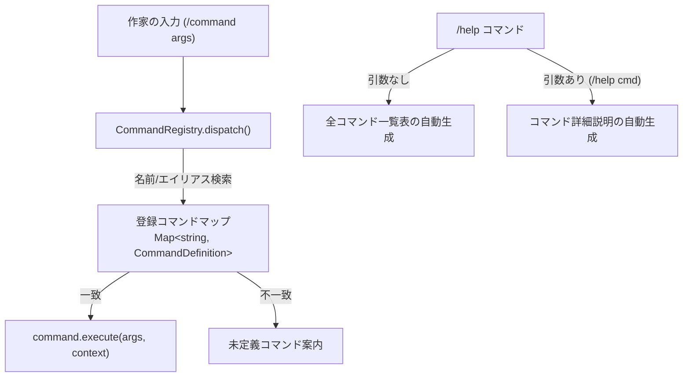

# 第5回：機能追加の前に！宣言的コマンド管理機構（CommandRegistry）で保守性と拡張性を高める

こんにちは！小説執筆補助用AIエージェントCLIツール（`novelaid-cli`）の開発メイキング、第5回です。

[前回（第4回）](./04_Pi_SDKセッション連携とCLI対話UIの実装.md) では、Pi Coding Agent SDKの `AgentSession` を活用し、ターミナル上でリアルタイムストリーミングによる会話が行えるインタラクティブ対話ループを完成させました。

AIと会話ができるようになったことで、「次は小説の設定資料を読み込むコマンドをつけよう！」「キャラクターシートを参照させよう！」と夢が広がるところです。

しかし、ここで作家（ユーザー）から非常に鋭く、重要なフィードバックをいただきました。  
**「様々な機能を組み込む前に、利用できるコマンドの管理方法について検討してください」**

今回は、将来の実装漏れやドキュメント不整合を根本から防ぐため、**「宣言的なコマンド管理機構（CommandRegistry）」** を設計・実装したリファクタリングの模様をお届けします！

---

## 1. 今回の課題と入力したプロンプト

作家（ユーザー）からいただいたプロンプトはこちらです。

> 様々な機能を組み込む前に、利用できるコマンドの管理方法について検討してください。  
> 現状の実装では、条件分岐、ヘルプ表示、それぞれでコマンドの比較、処理が個別に行われており、将来的に実装漏れが起きる可能性が高いです。  
> コマンドに対して、短い説明、詳細な説明、動作を登録、処理する仕組みが必要です。

さらに、

> 仕様を記載、コミットしてから実装に進んでください

と指示をいただき、実装に入る前にまず設計仕様書（[docs/dev/CLIコマンド管理仕様書.md](../../docs/dev/CLIコマンド管理仕様書.md)）を策定してコミットしてから実装に着手しました。

### 課題の要点
1. **二重管理の解消**: `if (cmd === "/exit")` のような条件分岐と、`/help` で表示するテキストが別々にハードコードされていた。
2. **実装漏れ・更新漏れのリスク**: 新しいコマンドを追加するたび、実行ロジックとヘルプ表示の両方を手動で更新する必要があり、不整合が起きやすい。
3. **詳細説明の欠落**: 引数（例: `/model <モデル名>`）の構文や詳しい使い方の案内ができない。

---

## 2. AIによる設計・実装プロセス

### ポイント1：Single Source of Truth（単一情報源）としてのコマンド定義

コマンドに関するすべての情報（名前、別名、構文、短い説明、詳細説明、実行ロジック）を1つのオブジェクトにまとめました（`src/commands/types.ts`）。

```typescript
export interface CommandDefinition {
  /** コマンドのプライマリ名（例: "help", "model"） */
  name: string;
  /** コマンドの別名（例: ["quit", "q"]） */
  aliases?: string[];
  /** 引数の構文表記（例: "[コマンド名]", "<モデル名>"） */
  usage?: string;
  /** 短い説明（一覧ヘルプ表示用） */
  description: string;
  /** 詳細な説明（/help <コマンド名> で表示する使用方法や仕様） */
  detail?: string;
  /** コマンドの実行ロジック */
  execute: (args: string, context: CommandContext) => Promise<void> | void;
}
```

### ポイント2：ディスパッチと自動ヘルプ生成を担う `CommandRegistry`

登録されたコマンド情報をもとに、実行判定（ディスパッチ）とヘルプ生成を一手に担う `CommandRegistry` クラスを作成しました（`src/commands/registry.ts`）。



これにより、対話ループ（`src/chat-session.ts`）内の入力処理は、わずか数行で記述できるようになりました：

```typescript
// スラッシュコマンドの処理（CommandRegistry へ一任）
if (userInput.startsWith("/")) {
  await registry.dispatch(userInput, commandContext);
  if (isExitRequested) {
    break;
  }
  rl.prompt();
  continue;
}
```

あの長かった `if-else` 分岐は完全に姿を消しました！

---

## 3. 実際に動かしてみた結果

新しく実装したコマンドレジストリの動作をターミナルで確認してみます。

```powershell
npm start
```

### 1. 一覧ヘルプ（`/help`）の自動生成
登録されたコマンド定義から、構文・説明・別名（エイリアス）が自動的に整列されて表示されます。

```text
作家> /help
【利用可能なコマンド一覧】
  /help [コマンド名]     利用可能なコマンド一覧、または特定コマンドの詳細ヘルプを表示します (別名: /?)
  /model [モデル名]     現在のモデル情報を表示します
  /clear            ターミナル画面を消去します (別名: /cls)
  /exit             対話セッションを終了してCLIを抜けます (別名: /quit, /q)

※ 各コマンドの詳細な使い方は「/help <コマンド名>」で確認できます。
```

### 2. 個別詳細ヘルプ（`/help model`）
コマンド名を引数に渡すと、詳しい構文や使用例が表示されます。

```text
作家> /help model
【コマンド詳細: /model】
構文: /model [モデル名]
エイリアス: なし
概要: 現在のモデル情報を表示します

[詳細説明]
現在セッションに設定されているAIモデルのID、表示名、およびコンテキスト窓サイズを表示します。
（将来のバージョンでは、引数にモデル名を指定しての動的切り替えに対応予定です）
```

### 3. エイリアス（別名）による実行
`/q` と入力するだけで、`exit` コマンドが安全に呼び出されて終了します。

```text
作家> /q
対話セッションを終了します。執筆お疲れ様でした！
```

---

## 💡 読者の皆さんも手元で動かしてみよう！（手動動作確認の手順）

お手元でコマンドヘルプの表示やエイリアスを体験できます。

1. **ビルドと起動**:
   ```powershell
   npm install
   npm run build
   npm start
   ```
2. **コマンドの実行**:
   - `/help`: 一覧ヘルプを表示
   - `/help model`: 詳細ヘルプを表示
   - `/q` または `/exit`: セッションを終了

詳しいコマンド仕様は、[動作確認ガイド](../../docs/manual/動作確認ガイド.md) にもまとめてあります。

---

## 4. まとめと次回予告

機能追加を急ぐのではなく、一歩立ち止まって「コマンド管理の仕組み」を美しく整理したことで、プロジェクトの保守性が飛躍的に向上しました。

### 今回の成果
* コマンド定義を Single Source of Truth（単一情報源）として宣言化。
* `CommandRegistry` による自動ディスパッチと、一覧・詳細ヘルプの自動生成を実現。
* エイリアス対応（`/?`, `/cls`, `/quit`, `/q`）により、ターミナル操作の快適性が大幅に向上。

### 次回予告
堅牢なコマンド管理基盤が整ったところで、次回は **Step 3（小説執筆補助の専門コンテキスト組み込み）** に本格着手します！  
「作家の思考パートナー」としての役割定義や、Markdownで書かれた小説の世界観・プロット資料を対話に取り込む仕組みを作っていきます。次回もどうぞお楽しみに！
