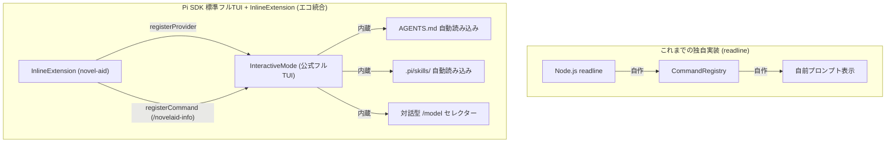

# 第6回：車輪の再発明をやめ、Pi SDK標準フルTUIとエコに統合する —— InlineExtensionでLM Studioと公式TUIを融合した実践

こんにちは！AIエージェントを活用した小説執筆補助CLIツール「`novelaid-cli`」の開発記、第6回です。

前回（第5回）では、CLIツール内のコマンドを宣言的に管理する「CommandRegistry」を自前で実装し、保守性を劇的に高めました。
しかし、その直後に作家（ユーザー）様から投げかけられた**鋭い問い**が、プロジェクトのアーキテクチャを一段上の次元へと引き上げることになりました。

今回は、自前でターミナルUIを作り込む「車輪の再発明」から脱却し、**Pi Coding Agent SDKが標準で持っているフルTUI（`InteractiveMode`）や拡張エコシステム（`InlineExtension`）を最大限に活かす「エコな統合方針」**へと舵を切った試行錯誤と実装の全貌をお届けします！

---

## 1. 作家（ユーザー）様からの鋭い問いかけ

前回、独自のコマンド管理機構を作り終えたところで、作家様から以下の問いかけをいただきました。

### ユーザープロンプト（抜粋）
> 次のステップに進む前に確認したいことがあります。  
> SDKの機能には、標準の pi coding agent の機能は含まれていますか？  
> 例えば、piで使用可能な`/login`コマンドや、AGENTS.mdの読み込みなど。  
> また、ユーザーによるSKILLの拡張などの機能が自動で有効なのか、有効にする手順があるのかなど  
>  
> readline方式とInteractiveModeの違いは？  
> 標準フルTUIとは？  
> 例えば、IDEのターミナルから呼ぶ場合はどちら？  
> また、引数により切り替えるような実装は可能？  
> 内部実装が大きく異なってくるのか、それほど変わらないのか？  
> 例えば、別なアプリに組み込んで一時的に使用したい場合は？  
> 実際上、先ほど実装したコマンド登録的な仕組みはSDKにないのか？  
> 標準フルTUIだとそれらの機能があるのであれば、なるべく標準の機能に合わせたい。  
> つまるところ、**Pi 標準の機能に追加機能を統合する方向でエコに実装したいです。**

まさに本質を突いたご指摘でした！

---

## 2. Pi Coding Agent SDKの深層調査

作家様のご要望を受けて、Pi Coding Agent SDK（`@mariozechner/pi-agent-core` および `@mariozechner/pi-agent`）の内部構造を徹底的にリサーチしました。
調査結果は開発仕様書 [Pi Coding Agent SDK仕様調査書.md](../../docs/dev/Pi_Coding_Agent_SDK仕様調査書.md) に詳細にまとめましたが、要点を整理すると驚くべき事実が分かりました。

### 発見したSDKの強力な標準機能
1. **`AGENTS.md` 自動読み込み**: カレントディレクトリや親ディレクトリの `AGENTS.md`、または `~/.pi/agent/AGENTS.md` を自動検出してシステムプロンプトに統合する。
2. **`.pi/skills/` 自動展開**: ワークスペース内のスキル（`SKILL.md`）を自動探索し、エージェントが自律的に実行可能なスキルとして登録する。
3. **`InteractiveMode`（フルTUI）**: 公式の `pi` CLI と全く同じ、リッチなMarkdown描画、対話型 `/model` 切り替えUI、認証ダイアログ（`/login`）、会話履歴ツリー（`/tree`）、セッション永続化が最初から全て組み込まれている。
4. **`ExtensionAPI`（公式プラグイン機構）**: SDKには公式の拡張機能インターフェースがあり、`registerProvider`（AIモデルの動的追加）や `registerCommand`（独自スラッシュコマンド追加）、各種イベントフックが標準サポートされている。

つまり、私たちが `readline` で一から手作りしていた「画面消去」「モデル切り替え」「コマンドディスパッチ」は、**SDKのフルTUIを使えば最初から最高峰の完成度ですべて用意されていた**のです。



---

## 3. 「エコな統合」の設計方針

私たちはただちに方針を転換しました。
**「Pi標準のフルTUIをメインエンジンとし、novelaid-cli独自の機能（LM Studio動的検知や小説専用コマンド）はSDK標準の `InlineExtension` として注入する」** というアーキテクチャです。

同時に、以下の柔軟性も確保することにしました：
- **通常起動（`novelaid`）**: SDK公式フルTUI（`InteractiveMode`）が起動。公式の全機能＋小説拡張が利用可能。
- **`--simple` オプション**: 従来の軽量な `readline` 対話モードも維持（軽量環境やスクリプト用）。
- **`--test` オプション**: 1往復の疎通テストを維持。
- **SDK標準フラグの透過**: `--list-models` や `--help` などの標準オプションもそのまま動作。

---

## 4. 実装：InlineExtensionとハイブリッドエントリーポイント

### 1. `InlineExtension` プラグインの作成（`src/extensions/novel-aid.ts`）
SDKの `ExtensionAPI` を使い、起動時にLM Studioの稼働状況をチェックしてモデルを動的登録する拡張プラグインを構築しました。

```typescript
import { ExtensionAPI, ExtensionFactory } from "@mariozechner/pi-coding-agent";
import { ModelManager } from "../model-manager.js";

export function createNovelAidExtension(): ExtensionFactory {
  return async (api: ExtensionAPI) => {
    const modelManager = new ModelManager();
    const lmModels = await modelManager.detectLMStudioModels();

    if (lmModels.length > 0) {
      // LM Studioのモデル群をSDKのプロバイダーとして動的登録
      api.registerProvider("lm-studio", {
        baseUrl: "http://localhost:1234/v1",
        apiKey: "lm-studio",
        api: "openai-completions",
        models: lmModels.map((m) => ({
          id: m.id,
          name: m.name,
          contextWindow: m.contextWindow,
          maxTokens: m.maxTokens,
          reasoning: false,
          input: ["text"],
          cost: { input: 0, output: 0, cacheRead: 0, cacheWrite: 0 },
        })),
      });
    }

    // 独自スラッシュコマンドの登録
    api.registerCommand("novelaid-info", {
      description: "novelaid-cli の接続状況と拡張情報を表示します",
      handler: async (_args, ctx) => {
        ctx.ui.notify(
          `novelaid-cli v0.1.0\nLM Studio モデル数: ${lmModels.length}件`,
          "info"
        );
      },
    });
  };
}
```

### 2. メインエントリーポイントの刷新（`src/cli.ts`）
Pi Coding Agent SDKの `main(args, { extensionFactories })` を直接呼び出すことで、公式フルTUIを即座に起動できるようにしました。

```typescript
import { main } from "@mariozechner/pi-coding-agent";
import { createNovelAidExtension } from "./extensions/novel-aid.js";

// 引数判定
if (args.includes("--test")) {
  await runTestMode();
} else if (args.includes("--simple")) {
  await runSimpleMode();
} else {
  // Pi SDK 公式フルTUI (InteractiveMode) を起動！
  await main(process.argv.slice(2), {
    extensionFactories: [createNovelAidExtension()],
  });
}
```

---

## 5. 動作検証：公式フルTUIとLM Studioの融合

ビルドを実行し、まずはSDK標準の `--list-models` フラグでモデル一覧を確認しました。

```powershell
npm start -- --list-models
```

すると、SDK標準のAnthropicやGeminiと並んで、私たちの `InlineExtension` が登録した `lm-studio` プロバイダーの9モデル（`qwen/qwen3-8b`, `google/gemma-3-4b` など）が一覧に完璧に認識・表示されました！

```text
Provider: lm-studio
  - qwen/qwen3-8b (Context: 128000)
  - google/gemma-3-4b (Context: 128000)
  ... (計9件)
```

そして通常起動（`npm start`）すると、公式CLIと寸分違わぬ美しいフルTUI画面が立ち上がります。
- ターミナル上でリッチなMarkdown描画とストリーミング表示が行われる
- `/model` を入力するとインタラクティブなモデル選択リストがポップアップし、方向キーで即座にLM Studioモデルに切り替えられる
- 独自コマンド `/novelaid-info` も完璧に認識される

車輪の再発明をやめ、エコシステムの力を借りることで、わずか数十行のコードで「本格的なAIエージェントCLI」の基盤が手に入った瞬間でした。

---

## 6. まとめと次回の予告

作家様からの「標準機能に追加機能を統合する方向でエコに実装したい」という一言が、コードの無駄を削ぎ落とし、圧倒的な機能性と拡張性をもたらしてくれました。

今回の成果：
1. **車輪の再発明の回避**: 重厚なTUIや履歴管理をPi SDK標準の `InteractiveMode` に完全委譲。
2. **InlineExtensionによる独自機能の注入**: ローカルLM Studioの自動検出・プロバイダー登録を公式プラグイン形式で実現。
3. **ハイブリッド運用の確立**: フルTUIを標準としつつ、軽量な `--simple` や疎通テスト `--test` もシームレスに両立。

### 次回予告
いよいよ **Step 3「小説執筆補助の専門コンテキスト組み込み」** に突入します！
Pi SDK標準の `AGENTS.md` 自動読み込み機構やスキル展開機能をフル活用し、小説のキャラクター設定、世界観、プロット資料をAIエージェントにどう読み込ませ、作家専属の編集者・アシスタントとして育て上げていくのか。その設計と実践をお届けします。どうぞお楽しみに！
