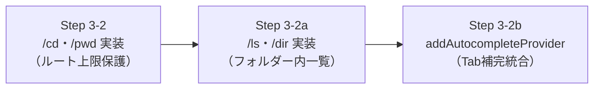

# 第7回：迷子にならない小説執筆空間！フォルダー階層移動（/cd）・一覧表示（/ls）・Tab補完の実装 —— Pi SDK拡張APIを活用した現在地管理

前回の第6回では、自作TUIの車輪の再発明をやめ、Pi Coding Agent SDK 公式のフルTUI（InteractiveMode）と `InlineExtension` を融合させることで、LM Studio のローカルAIモデルを公式TUI上で快適に対話できるハイブリッド環境を構築しました。

基盤が整ったところで、今回からいよいよ「小説執筆補助」としての専門機能の実装（Step 3）へと突入します！

小説の執筆現場では、1つの作品設定に対して複数の小説や短編、何十もの章フォルダーが存在します。一般的なAIツールでは「いま自分がどこにいて、どの章のコンテキストでAIと対話しているのか」が曖昧になりがちです。
そこで今回は、執筆プロジェクト内を自由に移動できる `/cd`、現在地の中身を確認できる `/ls`、そして快適な入力体験を支える **Pi SDK公式拡張APIによるTab補完機能** を実装しました。

---

## 1. 今回の課題と入力したプロンプト

小説執筆のフォルダー構造は、一般的なコードリポジトリとは大きく異なります。世界観や登場人物の設定フォルダー、全体プロットや章ごとのプロットフォルダー、そして実際の小説原稿フォルダーが深い階層構造を作っています。

作家さんから以下のような課題と要望が寄せられました。

### ユーザー入力プロンプト原文

> 小説執筆のフォルダー構造としては、以下のように階層構造がとられます。
> 特に、現状、１つの設定に対して、複数の小説、また、複数の章などを執筆します。
> その場合、同じ１話目でもどのフォルダーであるかで、小説、巻、章が異なります。
>
> （中略：00_設定、10_novels/01_僕は鑑定が使いたい/00_plot などのフォルダー構造ツリー）
>
> このような特殊事情があるため、現在の執筆フォルダーが重要になります。

> 階層は任意で作成、管理するため、通常のcdのように、`cd ..`などの機能は必須と考えられます
> （中略）
> まずは最低限必須の`/cd`から実装することになります。

> 次の機能を実装する前に、`/cd`を実際に使う上で必要な機能から実装します。
> まず、現在位置でのファイル、フォルダーの一覧を表示する機能。
> 次に、`/cd` の後のファイル、フォルダーに対する補完機能です。
> これらを計画に含めて検討してください。
>
> また、これらの機能はSDKに含まれていませんか？
> 特に、ファイル、フォルダー名の補完機能や補完に関する動作の機能についても調査してください。

---

## 2. AIによる設計・実装プロセス

「小さな単位で確実に進める」という方針に基づき、以下の3つのステップに細分化して段階的に設計・実装しました。



### ポイント1：プロジェクト境界を守る安全なナビゲーター（WorkspaceNavigator）

ターミナルの `cd` と同様に相対パスで自由に移動できるようにしつつ、**「プロジェクトルートより外側へは絶対に出られない（境界保護）」** という安全機構を組み込みました。

作家が誤って `cd ../../../..` と入力してしまっても、OSのエラーになったりPCの大事な別フォルダーに迷い込んだりせず、プロジェクトルートで安全に踏みとどまります。

```typescript
// src/workspace/navigator.ts より抜粋
export class WorkspaceNavigator {
  readonly rootDir: string;
  private currentDir: string;

  changeDirectory(targetInput?: string): NavigationResult {
    // 引数なしや ~ はルート復帰
    if (!targetInput || targetInput.trim() === "") {
      this.currentDir = this.rootDir;
      return { success: true, relativeDir: ".", message: "プロジェクトルートに移動しました。" };
    }

    const candidatePath = path.resolve(this.currentDir, targetInput.trim());

    // ルート上限ガード：プロジェクトルートの外側ならルートで停止
    if (!this.isWithinRoot(candidatePath)) {
      this.currentDir = this.rootDir;
      return {
        success: true,
        relativeDir: ".",
        message: "プロジェクトルートが上限です。ルートに移動しました。",
        isHitRootBoundary: true,
      };
    }
    // ...実在確認・ディレクトリ確認・移動更新
  }
}
```

このナビゲーターを `novelaidExtension` に統合し、`/pwd`（現在地表示）と `/cd <パス>`（階層移動）をスラッシュコマンドとして登録しました。

### ポイント2：フォルダー内をパッと確認できる `/ls`（`/dir`）コマンド

階層を移動した際、「このフォルダーの中にどんなファイルやプロットがあるか」を確認できないと作家は手探りになってしまいます。
そこで、現在フォルダー内の一覧を表示する `/ls`（Windows慣れした方向けに `/dir` も同義で登録）を実装しました。

* **フォルダーを優先表示**: ディレクトリを上部に集め、見通しを良くします。
* **ノイズの排除**: `.git` などの隠しファイルは自動的に除外します。
* **ファイルサイズの可読化**: バイト数を `KB` や `MB` に自動整形します。

### ポイント3：Pi SDK 公式拡張 API（`addAutocompleteProvider`）による Tab 補完

深いフォルダー名を毎回手作業で入力するのは作家にとって大きなストレスです。調査の結果、Pi SDK には独自の補完プロバイダーを多層スタックできる公式API `ctx.ui.addAutocompleteProvider` が用意されていることがわかりました！

入力欄の乗っ取りやハッキーなキーバインド割り込みを行うことなく、TUI標準の洗練されたポップアップ補完UIと完全に調和する形で `/cd` および `/ls` のパス補完を実現できました。

```typescript
// src/extensions/novelaid.ts より抜粋
api.on("session_start", async (_event, ctx) => {
  ctx.ui.addAutocompleteProvider((current: AutocompleteProvider): AutocompleteProvider => {
    return {
      async getSuggestions(lines, cursorLine, cursorCol, options) {
        const currentLine = lines[cursorLine] ?? "";
        const textBeforeCursor = currentLine.slice(0, cursorCol);

        // /cd, /ls, /dir コマンドの引数入力を検出
        const match = textBeforeCursor.match(/^\s*\/(?:cd|ls|dir)\s+([^\s]*)$/);
        if (!match) {
          return current.getSuggestions(lines, cursorLine, cursorCol, options);
        }

        const rawArg = match[1] ?? "";
        const result = navigator.getFolderSuggestions(rawArg);

        return {
          items: result.suggestions.map((s) => ({
            value: s.path,
            label: s.path,
            description: s.description,
          })),
          prefix: result.prefix,
        };
      },

      applyCompletion(lines, cursorLine, cursorCol, item, prefix) {
        return current.applyCompletion(lines, cursorLine, cursorCol, item, prefix);
      },

      shouldTriggerFileCompletion(lines, cursorLine, cursorCol) {
        return current.shouldTriggerFileCompletion?.(lines, cursorLine, cursorCol) ?? true;
      },
    };
  });
});
```

この補完プロバイダーは、以下のような高度な補完挙動をスマートにこなします。
1. `/cd ` と打つと、現在地直下のフォルダー一覧がポップアップ。
2. サブフォルダーにいる時だけ `../`（親フォルダー）が候補に現れ、ルートでは出ない（ルート上限ガードと完全連動）。
3. `/cd 10_novels/` のようにパスを入力すると、その先のフォルダー（`01_僕は鑑定が使いたい/` など）が自動的にサジェスト。
4. Tabキーを押すと末尾にスラッシュ（`/`）が付いた状態で確定し、そのまま連続して深い階層へと掘り下げられる。

---

## 3. 実際に動かしてみた結果

単体テストスクリプト（`scratch/test-navigator.mjs`）を作成し、全14パターンのテストケースを実行しました。

```text
=== WorkspaceNavigator 単体テスト ===
1. 初期状態:
・相対位置: .
・絶対パス: D:\home\mituha\repos\novel-tools\novelaid-cli

2. サブフォルダー移動 (src/workspace):
・結果: 作業フォルダーを移動しました: [src/workspace]
・相対位置: src/workspace

3. 親フォルダー移動 (..):
・結果: 作業フォルダーを移動しました: [src]
・相対位置: src

4. ルート上限ガードテスト (../../../../):
・結果: プロジェクトルートが上限です。外側へは移動できないため、ルート (novelaid-cli/) に移動しました。
・相対位置: .
・境界ヒット: true

7. 現在フォルダーの一覧取得 (listEntries):
・整形表示:
📂 フォルダー: [.] (合計: 11件)
  📁 [DIR]  bin/
  📁 [DIR]  dist/
  📁 [DIR]  docs/
  📁 [DIR]  making/
  📁 [DIR]  node_modules/
  📁 [DIR]  src/
  📄 [FILE] GEMINI.md (4.1 KB)
  📄 [FILE] package.json (640 B)
  📄 [FILE] README.md (1.1 KB)

10. ルート直下でのフォルダー補完候補 (getFolderSuggestions('')):
・候補一覧: bin/, dist/, docs/, making/, node_modules/, src/

12. パス付き補完 (getFolderSuggestions('src/')):
・候補一覧: ../, commands/, extensions/, workspace/

13. パス付きプレフィックス絞り込み (getFolderSuggestions('src/wo')):
・prefix: "wo"
・候補一覧: workspace/

14. ルート外・不正パス補完の保護 (getFolderSuggestions('../../')): 
・候補数: 0

✔ 全14テストケース合格！
```

TUIを起動して `/cd ` や `/ls ` を入力すると、黒を基調とした美しいPi TUIのポップアップ画面にサブフォルダー一覧が表示され、Tabキーでスイスイ補完される極めて快適な操作性を確認できました！

---

## 4. まとめと次回予告

今回の実装により、`novelaid-cli` の空間把握・移動能力が格段に進化しました。

* **どこにいるかが一目瞭然**: `/pwd` でいつでも現在地と書庫ルートを確認可能。
* **どこへでも安全に移動**: `/cd` でプロジェクト内を自在に行き来でき、ルート上限ガードで絶対に迷子にならない。
* **フォルダーの中身を即座に確認**: `/ls`（`/dir`）で見やすく一覧表示。
* **Tabキーで流れるように入力**: `addAutocompleteProvider` により、長いフォルダー名もストレスフリーに補完。

### 次回予告：DocumentType によるフォルダー・ファイル自動分類

物理的な移動基盤が完成したため、次はいよいよフォルダーやファイルに「役割と意味」を与える **Step 3-3: DocumentType 自動分類** に挑みます！

フォルダーの構造や Front Matter メタデータから、そこが「世界観設定（wiki）」なのか「プロット（plot）」なのか「小説原稿（novel）」なのかをAIが自動判別するインテリジェントな基盤を作っていきます。お楽しみに！
