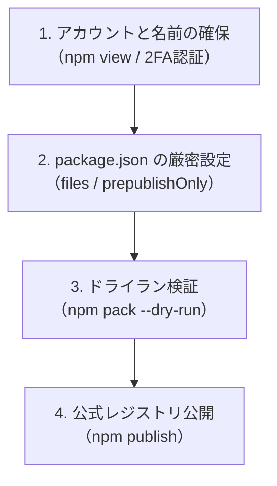

# 第8回：世界へ届け！自作CLIツールをnpmで公式公開する完全ロードマップ —— 失敗しないpackage.json設定と配布ファイル制御の極意

前回（第7回）では、小説執筆プロジェクト内を自由に移動できる `/cd` や一覧表示の `/ls`、そして Pi SDK 公式拡張 API（`addAutocompleteProvider`）を活用した動的 Tab 補完を実装し、執筆空間としてのナビゲーション基盤を固めました。

ここで一度、開発の歩みを少しだけ横に広げます。
本格的な小説補助機能（世界観・プロット・原稿の自動分類など）を詰め込む前に、**「世界中の作家や開発者が、コマンド一発（`npx novelaid-cli`）で即座にこのツールを動かせる状態」**、すなわち **npm（Node Package Manager）への公式パッケージ登録** を行いたいと考えました。

しかし、自作のCLIツールやTypeScriptプロジェクトをnpmに公開する際には、**「肝心の実行ファイルが含まれず動かない」「開発用の機密・内部ファイルが世界中にばら撒かれる」** といった初心者が必ずハマる落とし穴がいくつも存在します。

今回は、npm パッケージ登録に必要な手順の調査結果と、失敗しないための実践テクニックをメイキング記事として分かりやすくまとめました！

---

## 1. 今回の課題と入力したプロンプト

機能が大規模になってから公開しようとすると、パッケージ構成の見直しや依存関係の整理に多大なコストがかかります。「小さく動くものができた今のうちに、配布のパイプラインを通しておく」のがアジャイル開発の鉄則です。

### ユーザー入力プロンプト原文

> 本格的な機能追加の前に、npmへの登録を行いたいと考えています。
> まず、登録にあたって必要な手順などを調査、資料をまとめてください。
> また、登録方法の手順や注意事項などはメイキングの記事としてユーザー(読者)に分かりやすいっ記事にもまとめてください。

---

## 2. AIによる調査と設計プロセス

npm パッケージの公開は、単に `npm publish` コマンドを叩けば良いというものではありません。
事前準備から設定、事前検証、公開後の運用まで、大きく4つのステップがあります。



### ポイント1：パッケージ名の空き状況をチェックする

世界中に無数のパッケージが存在する npm では、使いたい名前が既に誰かに取られていることが日常茶飯事です。
まずはターミナルから `npm view` コマンドで調査しました。

```powershell
npm view novelaid-cli
```
結果は…… **`npm error 404 Not Found`**！
つまり、`novelaid-cli` という名前は世界中でまだ誰も使っておらず、**即座に登録可能**であることが判明しました（ちなみに短縮名の `novelaid` も空いていました）。

### ポイント2：【最大の落とし穴】`.gitignore` と `files` の罠

ここが今回の最も重要な技術的ハイライトです。

TypeScript プロジェクトを npm に公開する際、何も設定を変えずに公開シミュレーション（`npm pack --dry-run`）を実行したところ、恐ろしい事態が発覚しました。

```text
【何も設定していない初期状態のドライラン】
npm notice Tarball Contents
npm notice GEMINI.md                    ← 開発ルール（不要）
npm notice docs/dev/...                 ← 開発仕様書（不要）
npm notice making/logs/2026-10-18.md    ← 日次作業ログ（不要）
npm notice making/notes/...             ← メイキング連載記事（不要）
npm notice src/cli.ts                   ← TypeScriptソース（不要）
（合計 39 ファイル / 解凍後 283.2 kB）
※しかも、肝心の dist/（実行用JavaScript）が1つも入っていない！！
```

#### なぜこんなことが起きるのか？
npm は、プロジェクト内に `.npmignore` が存在しない場合、**自動的に `.gitignore` をフォールバックとして参照して除外判定を行う** という仕様を持っています。
* `.gitignore` にはビルド成果物である `dist/` が書かれているため、**肝心の実行ファイルが除外されてしまう**（ユーザーが実行すると `Cannot find module dist/cli.js` でクラッシュ）。
* 逆に、Gitで管理している `docs/` や `making/`、`src/` は `.gitignore` に書かれていないため、**世界中に丸見えで配布されてしまう**。

#### 解決策：`package.json` に `files` ホワイトリストを明記する
この問題は、`.npmignore` を作ってブラックリスト管理するのではなく、`package.json` の **`files` フィールドで配布したいフォルダーだけをホワイトリスト指定する** のが現代のベストプラクティスです。

```json
{
  "files": [
    "bin",
    "dist"
  ]
}
```
`files` に指定されたディレクトリは、`.gitignore` の除外設定をオーバーライドして最優先で同梱されます。そして、指定されていない `docs/` や `making/` は綺麗サッパリ自動除外されます。

### ポイント3：ビルド忘れを物理的に防ぐ `prepublishOnly` フック

TypeScript 開発者あるある第1位が、「TypeScriptのコードを修正したのに、`npm run build` を叩き忘れて古いJavaScriptのまま `npm publish` してしまう」という事故です。

これを人間の注意力に頼らず、自動化の仕組みで防止するのが npm ライフサイクルスクリプトの **`prepublishOnly`** です。

```json
{
  "scripts": {
    "dev": "tsx src/cli.ts",
    "build": "tsc",
    "prepublishOnly": "npm run build",
    "start": "node dist/cli.js"
  }
}
```
`prepublishOnly` に `"npm run build"` を登録しておくと、開発者が `npm publish` を実行した瞬間に、npm 自身が自動的に TypeScript の最新ビルドを走らせてからパッケージ化を行ってくれます。これでビルド忘れ事故は完全に根絶できます。

### ポイント4：アカウント準備と二要素認証（2FA）

npm でパッケージを公開・管理するには、以下のアカウント準備が必須です。

1. **[npmjs.com](https://www.npmjs.com/signup) でアカウント登録**:
   - メールアドレスの認証（メール内のリンクをクリック）を完了させる（未認証だと公開時に `403 Forbidden` エラーになります）。
2. **二要素認証（2FA）の設定**:
   - 昨今のサプライチェーン攻撃対策として、npm では公開アカウントに対する 2FA（Google Authenticator 等のワンタイムパスワード）の設定が強く推奨・義務化されています。
3. **ターミナルでのログイン**:
   - `npm login` で認証を通し、`npm whoami` で自分のユーザー名が表示されれば準備完了です。

---

## 3. 実際に動かしてみた結果（ドライラン検証）

`package.json` に `files` と `prepublishOnly` を設定し、`dist/` をクリーンビルドした上で、再度 `npm pack --dry-run` を実行しました。

```text
npm notice 📦  novelaid-cli@0.1.0
npm notice Tarball Contents
npm notice 1.1kB README.md
npm notice 105B bin/novelaid.js
npm notice 3.9kB dist/chat-session.js
npm notice 4.5kB dist/cli.js
npm notice 3.0kB dist/commands/builtin.js
npm notice 5.2kB dist/commands/registry.js
npm notice 7.1kB dist/extensions/novelaid.js
npm notice 2.6kB dist/model-manager.js
npm notice 11.4kB dist/workspace/navigator.js
npm notice 2.2kB dist/workspace/project-path.js
npm notice 788B package.json
...
npm notice Tarball Details
npm notice name: novelaid-cli
npm notice version: 0.1.0
npm notice package size: 13.9 kB          （← 87.6 kB から激減！）
npm notice unpacked size: 50.7 kB         （← 283.2 kB から激減！）
npm notice total files: 25                （← 39 ファイルから厳選！）
```

見違えるほどクリーンになりました！
* 内部の開発仕様書や日次ログは **100%完全にシャットアウト**。
* 配布されるのは `bin/` と `dist/`、そして `README.md` と `package.json` のみ。
* パッケージサイズは **13.9 kB** と超軽量。

これなら、誰が `npx novelaid-cli` を実行しても一瞬でダウンロードが完了し、安全・確実に起動します。

---

## 4. まとめと次回予告

本格的な機能追加に入る前に「配布パイプライン」を調査・整備したことで、以下の大きな成果が得られました。

* **世界公開の道が開通**: `novelaid-cli` のパッケージ名を確保し、公開設定が完了。
* **安全で軽量な配布パッケージ**: `files` ホワイトリストにより、内部資料を漏らさず最小限の成果物のみを同梱。
* **ビルド忘れの自動防止**: `prepublishOnly` で常に最新のコンパイル成果物を保証。

開発仕様としての完全なチェックリストや手順は、[docs/dev/npmパッケージ公開手順書.md](../../docs/dev/npmパッケージ公開手順書.md) にもまとめてあります。

### 次回予告：いよいよ小説執筆の本丸へ！DocumentType 自動分類

パッケージ配布の準備が完璧に整いました。次回からは、作家がフォルダーに配置した設定ファイルやプロット、原稿をAIが自動判別する **Step 3-3: DocumentType 自動分類（Front Matter 解析）** の実装に進みます。ご期待ください！
