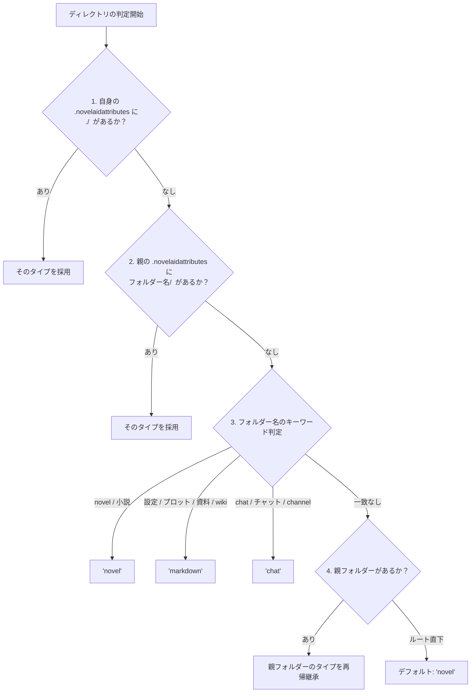

# 第9回：小説コンテキストの自動分類とAI現在地動的同期――DocumentTypeとbefore_agent_startフック

こんにちは！小説執筆補助CLIツール「**novelaid-cli**」開発チームの三葉（Mituha）です。

前回は、自作CLIツールをnpm公式レジストリへ公開するための完全手順と設定をまとめました。
今回は、`novelaid-cli` の存在意義でもある**「小説執筆に特化したAIコンテキスト管理」**の核心部分へと踏み込みます。

ユーザーがフォルダーを移動したとき、**「AIエージェントは今自分がどこにいて、何を書こうとしているのかをどうやって理解するのか？」**という深い問いに対する、Pi Coding Agent SDK を活かした美しいアーキテクチャの実現過程をお届けします！

---

## 1. ユーザーからの鋭い疑問：「AIにとっての現在地（pwd）とは何か？」

フォルダー移動（`/cd`）や一覧表示（`/ls`）を実装した直後、開発の現場で以下のような本質的な疑問が提起されました。

```text
現在のカレントディレクトリの管理はカレントディレクトリを内部で保持しており、
processのカレントディレクトリはプロジェクトルートはそのままとなっています。
piの機能自体はカレントディレクトリをどのように扱っていますか？
piに対してプロジェクトルートを設定するような機能はありませんか？
AIにpwdを渡した場合、カレントディレクトリを返すことより、何らかの処理があるのではないでしょうか？
```

これはまさに、**「汎用コーディング用エージェント」の上に「小説執筆アシスタント」を構築する上での最大の設計課題**でした。

単に画面上に「現在のフォルダーはここです」とトースト表示するだけでは、AI自身は何一つ文脈を把握していません。AIエージェントにとって「現在地」がわかることの真の価値は、以下の2点にあります：

1. **暗黙のファイル解決**: ユーザーが「第1話の推敲をして」と言ったとき、プロジェクトルート全体を探すのではなく、現在の作業フォルダー直下を最優先で対象にできる。
2. **執筆モード・ペルソナの自動最適化**: 今いる場所が「小説本文（原稿）」なのか「キャラクター設定」なのか「プロット構成」なのかによって、AIの振る舞いや注力ポイントを自動で切り替える。

この理想を実現するため、まずは Pi Coding Agent SDK（`@earendil-works/pi-coding-agent`）本体の内部実装を詳細に調査しました。

---

## 2. Pi SDKにおけるカレントディレクトリの扱いと二層構造

Pi SDKのソースコードおよび型定義を解析した結果、以下の仕組みが明らかになりました。

1. **セッション基底パスとしての `cwd`（不変）**:
   - `main(args)` や `InteractiveMode({ cwd })` で起動された際、セッション全体のプロパティとして固定されます。
2. **すべての組み込みツールの起点**:
   - `read`, `write`, `edit`, `ls`, `grep`, `bash`, `powershell` 等の全ツールは、相対パスを `ctx.cwd || cwd`（プロジェクトルート）を起点に解決します。
3. **システムプロンプトの `<cwd>` セクション**:
   - Pi SDK標準の `buildSystemPromptSections()` は、プロンプト冒頭に `<cwd>D:/path/to/project</cwd>` を自動注入し、AIにプロジェクトルートを伝えています。

### 設計上の判断：二層ディレクトリ構造の採用
もし対話中に Node.js の `process.chdir()` を実行してプロセスの `cwd` を動かしてしまうと、Pi SDK組み込みツールの相対パス解決基準が狂い、ユーザーが親ディレクトリへ意図せず脱出してしまう（境界保護が崩れる）危険が生じます。

そこで、**「Pi本体のベース `cwd` はプロジェクトルート（書庫ルート）に固定し、作業フォルダーは `WorkspaceNavigator` で仮想管理する」**という二層構造を維持することが、セキュリティと堅牢性の観点から最適解であると判断しました。

---

## 3. DocumentType と `.novelaidattributes` の導入

AIに作業フォルダーの文脈を理解させるためには、まず**「そのフォルダーやファイルが小説なのか設定なのか」**を客観的に判定できる基準が必要です。

先行プロジェクトであるデスクトップ版エディター `novelaid-editor`（`src/novelaid-fs/main/FileService.ts`）の実績ある仕様を完全移植しました。

```typescript
export type NovelaidDocumentType =
  | 'novel'     // 小説本文・原稿（.txt、または .novelaidattributes で指定された .md）
  | 'markdown'  // 設定・プロット・資料等の汎用マークダウン（.md）
  | 'chat'      // チャットチャンネル（.ch）
  | 'image'     // 画像ファイル
  | 'css'       // スタイルシート
  | 'gitDiff'   // Git差分
  | 'browser'   // ブラウザ表示
  | 'unknown';  // 未知・その他
```

### フォルダー種別判定の優先フロー
フォルダーがどのドキュメントタイプに属するかは、以下の優先順位でスマートに判定されます：



### `.novelaidattributes`（非再帰の原則）
設定ファイル `.novelaidattributes` を置くことで、ルールを明示的に上書きできます。Gitの属性と異なり、局所性を守るため**再帰的な適用は行わず、直下のファイルとフォルダーのみを対象**とします。

```text
# 小説原稿フォルダー内の .md を本文として扱う指定
*.md novel
*novel*/ novel
./ markdown
```

さらに、設定用Markdownの先頭に YAML Front Matter（`tags: [character, 主人公]` 等）がある場合は、メタデータパーサーによってキャラクター設定やプロット構成をより詳細に識別します。

---

## 4. `before_agent_start` フックによる動的XMLコンテキスト注入

ここからが今回のクライマックスです。
Pi SDK公式の拡張ライフサイクルイベント **`before_agent_start`** を活用します。

このイベントは、ユーザーが入力欄でプロンプトを送信し、**AIエージェントが推論・思考を開始する直前**に呼び出されます。ここでシステムプロンプトのセクション（`event.systemPromptOptions.sections`）を動的に書き換えることができます！

### 実装コード（`src/extensions/novelaid.ts`）

```typescript
// ドキュメントタイプに応じたAI執筆ペルソナ
export function getPersonaGuideline(docType: NovelaidDocumentType): string {
  switch (docType) {
    case "novel":
      return "The current workspace is for novel manuscript. Focus on literary expression, prose rhythm, dialogue, descriptive details, and emotional depth.";
    case "markdown":
      return "The current workspace is for plot, world settings, characters, or research notes. Focus on logical consistency, cause-and-effect, foreshadowing, and structured outlines.";
    case "chat":
      return "The current workspace is for informal brainstorming or conversational ideation. Engage freely, suggest creative alternatives, and bounce ideas.";
    default:
      return "Provide general novel writing and world-building assistance aligned with the project structure.";
  }
}

// AIエージェント思考開始前の動的注入
api.on("before_agent_start", async (event, _ctx) => {
  const rel = navigator.getRelativeDir();
  const activeDir = !rel || rel === "." ? "(root)" : rel;
  const currentDir = navigator.getCurrentDir();
  const dirType = navigator.getDirectoryType(currentDir);
  const persona = getPersonaGuideline(dirType);

  // AIに届く構造化コンテキスト
  const workspaceContent = [
    `- Active Directory: [${activeDir}]`,
    `- Document Type: ${dirType}`,
    `- Working Scope Rule: When the user refers to files without an explicit directory path (e.g. "第1話.txt" or "setting.md"), look in Active Directory first before the project root.`,
    `- Role Guideline: ${persona}`,
  ].join("\n");

  event.systemPromptOptions.sections["novelaid_workspace"] = workspaceContent;
});
```

この連携により、システムプロンプト内に以下のタグが自動的に生成・更新されます：

```xml
<novelaid_workspace>
- Active Directory: [10_novels]
- Document Type: novel
- Working Scope Rule: When the user refers to files without an explicit directory path (e.g. "第1話.txt" or "setting.md"), look in Active Directory first before the project root.
- Role Guideline: The current workspace is for novel manuscript. Focus on literary expression, prose rhythm, dialogue, descriptive details, and emotional depth.
</novelaid_workspace>
```

---

## 5. 動作確認と単体テスト

実際にモック環境を構築し、移動に伴ってAIのコンテキストが正しく切り替わるかを自動テスト（`scratch/test-workspace-prompt.mjs`）で検証しました。

```text
=== Step 3-3b 単体テスト開始 ===

[Test 1] getPersonaGuideline の出力検証
✔ getPersonaGuideline テスト合格

[Test 2] ExtensionAPI before_agent_start イベントハンドラー動作検証
・ルート時の生成セクション:
 - Active Directory: [(root)]
- Document Type: novel
- Role Guideline: The current workspace is for novel manuscript. Focus on literary expression, prose rhythm...

・10_novels 移動後の生成セクション:
 - Active Directory: [10_novels]
- Document Type: novel

・00_settings 移動後の生成セクション:
 - Active Directory: [00_settings]
- Document Type: markdown
- Role Guideline: The current workspace is for plot, world settings, characters, or research notes. Focus on logical consistency...

・/pwd 通知内容:
 【現在の作業フォルダー】
・相対位置: [00_settings]
・フォルダー種別: markdown
・絶対パス: ...\00_settings
・書庫ルート: ...
✔ ExtensionAPI before_agent_start ハンドラー動作検証テスト合格

=== 全テストケース合格！ ===
```

ユーザーが `/cd 10_novels` に移動すれば、AIは即座に**小説本文の文体や感情描写に注力する編集者**に変わり、`/cd 00_settings` に移動すれば、**プロットの論理破綻や伏線回収をチェックする構成作家**へと自然に姿を変えます。

画面の `/pwd` や `/novelaid-info` にもフォルダー種別（`novel`, `markdown` 等）が表示されるようになり、執筆者が今どのような環境にいるのかが一目で把握できるようになりました。

---

## 6. まとめと次回予告

今回は、ユーザーの鋭い問題意識を起点として、Pi SDKの奥深い仕組みを探求し、**「ディレクトリ移動とAIコンテキストの動的同期」**という強力な基盤を完成させました。

* **Pi本体のベース `cwd` は固定保護しつつ、作業フォルダーは仮想追跡**
* **`novelaid-editor` 互換の `NovelaidDocumentType` による自動種別判定**
* **`before_agent_start` による思考直前の動的XMLプロンプト注入**

次回は、この分類基盤を活用した**セマンティックショートカットコマンド（`/wiki`, `/plot`, `/novel`）**の実装へと進みます。執筆者が迷わず設定資料や原稿へと瞬時にジャンプできる快適な執筆体験を追求していきます。

次回もお楽しみに！
